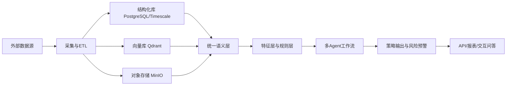
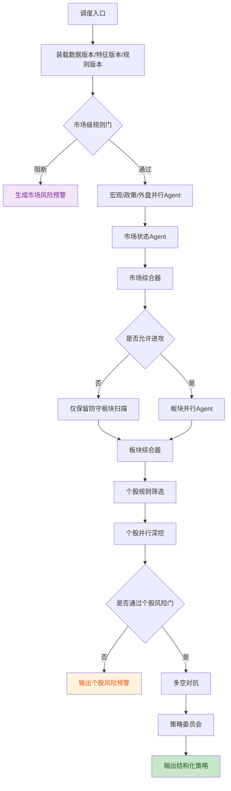

# A股 AI 投研中台系统架构设计 (V1.1)

## 1. 系统定位与核心目标

### 1.1 项目背景
中国 A 股市场具有强政策驱动、强题材轮动、强资金博弈、强情绪放大效应等特点。传统“单模型长提示词”方案虽然可以生成看似完整的解读，但在以下关键点上存在天然不足：

- 无法稳定处理宏观到个股的分层逻辑。
- 无法对不同时间窗的信息做严格对齐。
- 无法将事件、情绪、资金、板块、技术面、财务面统一到同一个分析坐标系。
- 无法对策略输出做结构化约束、验证和复盘。

因此，本项目定位为一个**独立的新项目**，借鉴 TradingAgents 的多 Agent 思想，但不复用其业务结构；目标是建设一个**机构级、可扩展、可审计、可复盘**的 A 股 AI 投研中台。

### 1.2 核心价值
- 以“自上而下”方式整合国际、宏观、政策、板块、资金、个股信息。
- 以“语义层 + 特征层 + 规则层 + Agent 层”替代简单的“提示词 + tools 拼装”。
- 以结构化预测和策略输出支撑后续评估、复盘、Prompt 调优和产品演进。
- 以批处理计算为主、交互式追问为辅，兼顾稳定性与即时性。

### 1.3 核心产出
- **指数视角**：T+1、T+7、T+30 的方向、波动与风险判断。
- **板块视角**：主线板块识别、持续性评估、轮动预判。
- **个股视角**：次日买卖策略、未来 7 天与 30 天走势估算、持仓规划。
- **风险预警**：ST、减持、解禁、问询函、流动性枯竭、抱团瓦解、极端波动等多级预警。

### 1.4 非目标
- 不直接承诺实盘自动下单。
- 不追求高频、低延迟撮合交易。
- 不把所有复杂逻辑都交给 LLM 推理。

---

## 2. 设计原则

### 2.1 架构原则
- **先结构化，再智能化**：先定义数据契约、特征契约、输出契约，再接入 Agent。
- **先规则兜底，再交给 LLM**：A 股硬风控不能只靠模型讨论。
- **先预计算，再摘要推理**：能用代码确定算出来的指标，不让 LLM重复计算。
- **强解耦、弱依赖**：数据源、特征、规则、Agent、API 层相互独立。
- **可验证、可回放、可审计**：所有预测与策略必须可追溯到输入数据和版本。

### 2.2 核心分层
本项目不采用简单四层，而采用六层架构：

1. **Source Layer**：外部数据源与采集接入。
2. **Storage Layer**：结构化库、向量库、对象存储。
3. **Semantic Layer**：统一语义对象与事件标准化。
4. **Feature & Rule Layer**：特征快照、标签、风控规则、策略约束。
5. **Agent Layer**：多 Agent 分析、辩论与决策。
6. **Service & Application Layer**：批处理调度、交互问答、报告服务。

---

## 3. 总体技术架构

### 3.1 技术栈选型
- **核心语言**：Python 3.11+
- **Agent 编排框架**：LangGraph
- **Web/API 框架**：FastAPI
- **任务队列与异步执行**：Celery + Redis
- **结构化数据库**：PostgreSQL + TimescaleDB
- **向量数据库**：Qdrant
- **对象存储**：MinIO
- **ORM / 数据访问**：SQLAlchemy + Alembic
- **数据计算**：Pandas + Polars + NumPy
- **模型服务**：DeepSeek API 为主，Embedding 使用 BGE-M3 或同级中文向量模型
- **可观测性**：Structlog / Loguru + OpenTelemetry + Prometheus

### 3.2 选型理由
- **LangGraph**：适合表达多阶段、多角色、有条件短路和状态流转的工作流。
- **PostgreSQL + TimescaleDB**：适合结构化时序指标、公告元数据、事件索引和复盘查询。
- **Qdrant**：在当前阶段比 Milvus 更轻、更易维护，适合中大型文本检索场景；若后期向量规模暴涨，再评估 Milvus。
- **Celery + Redis**：适合批处理、重试、异步回填、交互式请求拆分。
- **MinIO**：存储原始研报、公告全文、新闻快照、HTML 报告等大对象。

### 3.3 架构示意


---

## 4. 数据源矩阵与信息梯度

### 4.1 信息梯度
系统按“宏观 -> 中观 -> 微观”三层组织，但每层都同时保留结构化数据与文本语义数据。

| 层级 | 核心问题 | 主要对象 |
| :--- | :--- | :--- |
| 宏观层 | 市场整体风险偏好是否切换？ | 全球指数、利率、汇率、大宗、地缘、政策 |
| 中观层 | 哪些方向是主线？主力资金是否聚焦？ | 板块、概念、ETF、北向、国家队、抱团 |
| 微观层 | 具体哪只股票值得交易？ | 个股、财务、公告、筹码、技术、情绪 |

### 4.2 数据源分类

| 类别 | 数据内容 | 优先来源 | 备注 |
| :--- | :--- | :--- | :--- |
| 国际行情 | 美股指数、美元指数、原油、黄金、铜、日经、港股 | 商业终端/Wind/Choice | 必须保留时间戳与交易时段 |
| 宏观新闻 | 央行、财政、产业政策、国际突发事件 | 财联社、金十、新华社、央行网站 | 既入结构化库，也入向量库 |
| A股基础行情 | 指数、个股 OHLCV、成交额、换手率 | 商业行情源 + AkShare/BaoStock 补充 | 结构化库为主 |
| 资金数据 | 北向、ETF 申赎、行业资金流、主力净流入 | 商业 L2 / 同花顺 / 东财 | 结构化库为主 |
| 板块与概念 | 行业、概念、成分股、龙头股、轮动热度 | 同花顺 / 东财 / 商业终端 | 结构化库 + 向量库 |
| 公告与财务 | 财报、业绩预告、减持、解禁、问询函、并购重组 | 巨潮、交易所、商业终端 | 强结构化抽取 |
| 情绪与舆情 | 股吧、研报、媒体热词、社交热度 | 股吧、媒体、券商研报 | 向量库 + 结构化标签 |
| 涨停板生态 | 涨停池、炸板池、跌停池、封板时间、连板数、炸板次数 | 东方财富（AkShare: `stock_zt_pool_em`, `stock_zt_pool_zbgc_em`, `stock_zt_pool_dtgc_em`） | 盘后数据，约15:30可获取，结构化库 |
| 龙虎榜 | 买入/卖出前五席位、营业部名称、净买入额、机构席位标记 | 东方财富（AkShare: `stock_lhb_detail_em`, `stock_lhb_hyyyb_em`, `stock_lhb_stock_detail_em`） | 盘后数据，约17:00可获取，结构化库+席位白名单 |
| 分钟级K线 | 5/15/30/60分钟OHLCV，用于识别日内走势形态 | 东方财富（AkShare: `stock_zh_a_hist_min_em`） | 结构化库，用于弱转强/地天板等日内形态检测 |

### 4.3 数据入库原则
- 原始文本不能只入向量库，必须保留结构化元信息。
- 每条数据必须带：
  - `source`
  - `source_type`
  - `published_at`
  - `captured_at`
  - `market_scope`
  - `symbol / sector / concept`
  - `confidence`
  - `version`

---

## 5. 统一语义层与特征契约

### 5.1 为什么必须引入语义层
如果没有统一语义层，后续每个 Agent 都会直接从数据库、向量库、接口中各自取数，导致：

- 逻辑重复实现。
- 变量口径不一致。
- Prompt 上下文混乱。
- 很难审计和复盘。

因此，数据层与 Agent 层之间必须增加 **Semantic Layer**。

### 5.2 核心语义对象
建议统一定义以下对象：

- `MacroSnapshot`
- `MarketSnapshot`
- `SectorSnapshot`
- `ConceptSnapshot`
- `InstitutionFlowSnapshot`
- `StockSnapshot`
- `EventSnapshot`
- `SentimentSnapshot`
- `StrategyScenario`
- `RiskAlert`

### 5.3 特征契约
每个语义对象都需要可直接被 Agent 消费的“特征快照”。

#### MacroSnapshot
- 利率方向
- 汇率方向
- 大宗商品方向
- 全球风险偏好
- 地缘冲突等级
- 国内政策宽松/收紧评分
- 海外科技股情绪代理

#### SectorSnapshot
- 板块涨跌幅
- 成交额占比
- 板块扩散度
- 龙头集中度
- 持续性评分
- 轮动速度
- 主线/支线/非主线标记

#### StockSnapshot
- 流动性评分
- 相对强弱
- 量价结构
- 波动等级
- 估值分位
- 财务健康评分
- 抱团程度
- 公告风险等级
- 概念纯度

---

## 6. 指标体系与变量清单

### 6.1 市场状态变量
- 全市场成交额
- 涨跌家数
- 涨停/跌停家数
- 连板高度
- 情绪周期阶段
- 风格偏向（权重/成长/题材）
- 北向资金净流入
- ETF 主动申赎

### 6.2 板块变量
- 板块成交额
- 板块成交额占比
- 龙头股强度
- 跟风股数量
- 板块一致性
- 分歧转一致信号
- 题材热度
- 消息催化强度

### 6.3 个股变量
- 价格位置分位
- 量能变化
- 波动率
- 封单质量
- 开板次数
- 筹码集中度
- 机构持仓变化
- 大股东减持/解禁压力
- 财报质量
- 事件催化强度

### 6.4 风险变量
- ST / 退市风险
- 停牌风险
- 重大诉讼或立案
- 业绩暴雷
- 流动性枯竭
- 高位情绪退潮
- 估值过热
- 板块瓦解

### 6.5 策略变量
- 时间窗（T+1 / T+7 / T+30）
- 策略类型（趋势 / 事件 / 轮动 / 防守）
- 入场条件
- 加仓条件
- 减仓条件
- 止损条件
- 止盈条件
- 最大持仓
- 失效条件
- 置信度

### 6.6 板块主线生命周期识别框架

#### 6.6.1 设计目标
板块层不是简单做“今日最强板块排序”，而是要回答四个问题：

1. 哪些方向值得进入重点观察池？
2. 哪些方向正在演化为市场主线？
3. 哪些方向仍具备持续性，哪些只是脉冲异动？
4. 哪些方向已经进入分歧或退潮，应提前离场？

因此，板块层应实现为 **生命周期状态机 + 证据分层系统 + 提前布局/提前离场引擎**，而不是单一评分器。

#### 6.6.2 上位约束：三个市场总开关
任何板块判断都不能脱离市场环境单独解释，至少要受到以下三个“总开关”约束：

1. **风险偏好开关**
   - 市场当前处于风险偏好回暖、高潮、分歧还是退潮。
2. **风格偏向开关**
   - 当前偏权重、偏成长、偏题材、偏防御，还是偏中特估/高股息。
3. **流动性开关**
   - 当前市场是否有足够流动性支撑板块扩散，还是只能集中抱团少数龙头。

同样的板块异动，在 `RiskOn`、`RiskOff`、`权重托底`、`缩量混沌` 等市场状态下，含义完全不同。因此板块模型必须先读取市场级结论，再做中观判断。

#### 6.6.3 生命周期状态机
板块生命周期建议划分为以下六个状态：

| 状态值 | 中文名称 | 含义 | 核心动作 |
|---|---|---|---|
| `watching` | 观察中 | 出现了资金或事件异动，但证据不足以定义为主线 | 纳入观察池，不做重仓假设 |
| `emerging` | 潜在主线 | 事件与资金开始共振，值得重点跟踪与轻仓预埋 | 进入重点跟踪池 |
| `confirmed` | 确认主线 | 龙头、扩散、成交和持续性均已形成合力 | 视为主线之一 |
| `strengthening` | 强化主线 | 赚钱效应扩散，高低位联动良性，市场共识增强 | 允许继续跟踪和寻找补涨 |
| `diverging` | 分歧主线 | 仍是主线，但内部开始分化，风险与机会并存 | 谨慎参与，缩小战线 |
| `decaying` | 退潮主线 | 龙头、扩散、资金或风险偏好中的关键支柱明显转弱 | 以离场和风险控制为主 |

#### 6.6.4 主因果链
板块主线的标准演化链应理解为：

`事件/资金起点 -> 板块成交额占比提升 -> 多股同步异动 -> 龙头确立 -> 板块扩散 -> 情绪放大 -> 强化或分歧 -> 资金衰减/风险暴露 -> 退潮`

这条链条中的各类指标地位不同：

- `事件/资金`：源头层，负责发现候选方向
- `成交占比/同步异动`：早期验证层，负责判断是否值得持续观察
- `龙头/扩散/持续性`：确认层，决定是否升级为主线
- `情绪/讨论度`：放大量，负责强化或提示过热
- `龙头衰减/资金迁移/风险事件`：退出层，负责提前离场

#### 6.6.5 四类指标分层

##### A. 起点指标
用途：尽可能早地发现值得观察的方向，允许一定误报，但不能漏掉真正的新主线起点。

| 指标名 | 作用 | 证据类型 | 是否前瞻 | 是否适合规则层 |
|---|---|---|---|---|
| `sector_turnover_share_delta` | 识别板块成交额占市场成交额的突增 | 统计验证型 | 是 | 是 |
| `sector_turnover_share_trend` | 判断成交额占比是否连续抬升 | 统计验证型 | 是 | 是 |
| `sector_sync_move_ratio` | 判断板块内是否多股同步异动 | 统计验证型 | 是 | 是 |
| `sector_net_flow_acceleration` | 识别板块净流入是否加速 | 统计验证型 | 是 | 是 |
| `event_freshness_score` | 判断催化是新刺激还是旧闻翻炒 | 辅助叙事型 | 是 | 否 |
| `event_sector_mapping_score` | 判断事件与板块逻辑映射是否真实有效 | 经验规则型 | 是 | 部分适合 |
| `leader_ignition_score` | 识别核心个股是否主动点火 | 历史经验型 | 是 | 部分适合 |

起点层规则：
- 资金先行，可进入 `watching`
- 事件 + 资金共振，才升级为 `emerging`
- 单纯情绪热度不能作为起点
- 单只个股异动不能单独定义板块主线

##### B. 确认指标
用途：将候选方向升级为“确认主线”，防止把脉冲题材误判为主线。

| 指标名 | 作用 | 证据类型 | 是否前瞻 | 是否适合规则层 |
|---|---|---|---|---|
| `leader_strength_score` | 衡量龙头股相对强弱、承接与辨识度 | 统计验证型 + 历史经验型 | 中等 | 混合 |
| `breadth_score` | 衡量板块扩散度与中位数表现 | 统计验证型 | 否 | 是 |
| `ladder_integrity_score` | 判断龙头、强跟风、低位补涨是否形成梯队 | 历史经验型 | 否 | 部分适合 |
| `turnover_share_stability` | 判断板块成交额占比能否维持 | 统计验证型 | 否 | 是 |
| `persistence_score` | 判断板块是否连续强于市场与多数板块 | 统计验证型 | 否 | 是 |
| `consensus_score` | 判断市场是否开始形成主线共识 | 经验规则型 | 否 | 否 |

确认层原则：
- 没有龙头和扩散，就不能定义为真正主线
- 情绪热度只能辅助确认，不能代替结构确认

##### C. 强化指标
用途：判断主线是否进入“可持续赚钱阶段”，服务继续持有和板块内部轮动挖掘。

| 指标名 | 作用 | 证据类型 | 是否前瞻 | 是否适合规则层 |
|---|---|---|---|---|
| `profit_effect_spread_score` | 判断赚钱效应是否从龙头扩散到板块 | 统计验证型 | 中等 | 是 |
| `high_low_coordination_score` | 判断高位龙头与低位补涨是否良性联动 | 历史经验型 | 中等 | 部分适合 |
| `branch_rotation_health_score` | 判断同主线分支轮动是否健康 | 历史经验型 | 中等 | 否 |
| `sentiment_amplification_score` | 判断情绪是否在强化而非失控 | 辅助叙事型 + 经验规则型 | 中等 | 否 |
| `follow_through_quality_score` | 判断上涨后的承接质量与次日延续性 | 统计验证型 | 中等 | 是 |

强化层原则：
- 强化不是越热越好
- 强化阶段往往也是离过热最近的阶段，必须和退出层联动监控

##### D. 退出指标
用途：尽量比市场共识更早识别退潮，服务提前离场。

| 指标名 | 作用 | 证据类型 | 是否前瞻 | 是否适合规则层 |
|---|---|---|---|---|
| `leader_decay_score` | 判断龙头强度是否开始衰减 | 统计验证型 + 历史经验型 | 是 | 混合 |
| `breadth_contraction_score` | 判断板块扩散是否收缩 | 统计验证型 | 是 | 是 |
| `turnover_share_fall_score` | 判断板块成交额占比是否回落 | 统计验证型 | 是 | 是 |
| `high_level_loss_effect_score` | 判断高位股亏钱效应是否扩大 | 统计验证型 + 历史经验型 | 是 | 是 |
| `sentiment_divergence_score` | 判断情绪是否从一致转向分歧 | 经验规则型 | 是 | 否 |
| `capital_rotation_out_score` | 判断资金是否开始迁移到新方向 | 统计验证型 | 是 | 是 |
| `risk_event_pressure_score` | 判断监管、减持、问询等风险事件压力 | 经验规则型 + 事件型 | 是 | 是 |
| `market_regime_mismatch_score` | 判断板块风格是否与市场环境错配 | 经验规则型 | 是 | 部分适合 |

退出层原则：
- 退出信号应比入场信号更敏感
- 不要求全部确认，只要龙头、扩散、资金、风险中有两到三个核心支柱同时转弱，即应降级或退出

#### 6.6.6 状态迁移逻辑

**`watching -> emerging`**
- 满足：资金先行明显，或事件催化明确
- 并同时至少满足一个辅助条件：多股同步异动 / 板块成交占比抬升 / 龙头初步点火

**`emerging -> confirmed`**
- 必须看到：龙头明确、扩散形成、成交占比维持、连续性出现

**`confirmed -> strengthening`**
- 必须看到：赚钱效应扩散、分支轮动健康、高低位联动、承接质量良好

**`strengthening -> diverging`**
- 看到以下部分信号即可：龙头波动加大、跟风弱化、扩散减速、一致性过高后开始分歧

**`diverging -> decaying`**
- 看到以下两到三类核心信号：龙头显著转弱、扩散明显收缩、成交额占比回落、风险事件增加、资金明显迁出、市场风格切换

#### 6.6.7 规则层与 Agent 层分工

更适合规则层的指标：
- 板块成交额占比
- 板块净流入变化
- 扩散度
- 连续强势天数
- 高位亏钱效应
- 资金迁移速度
- 风险事件直接命中

更适合 Agent 层解释的指标：
- 事件与板块映射强度
- 主线叙事是否成立
- 分支轮动是否健康
- 市场是否形成隐性共识
- 市场风格切换对该板块的压制或放大
- 国家队/权重托底对题材节奏的影响

混合型指标：
- 龙头强度
- 梯队完整性
- 高位一致性是否过热
- 情绪从强化到分歧的切换

#### 6.6.8 总结原则
板块层采用“**事件/资金双起点、龙头/扩散/成交确认、情绪辅助强化、风险/资金衰减提前退出**”的生命周期识别框架，以分层状态机替代静态排序，以证据分层替代混合堆料。该框架直接服务于三个目标：

- 充分识别市场
- 尽量提前布局
- 尽量提前离场

#### 6.6.9 市场总开关的字段级定义
板块层的所有判断，都应先读取市场层的三个总开关。建议在 `feature_market_snapshot` 中至少沉淀以下字段：

| 字段名 | 含义 | 推荐计算口径 | 取值建议 | 依据类型 |
|---|---|---|---|---|
| `risk_preference_regime` | 市场风险偏好状态 | 结合涨跌家数、涨停/跌停、连板高度、题材中位数、亏钱效应分布综合判定 | `risk_on / neutral / risk_off` | 统计验证型 + 经验规则型 |
| `risk_preference_score` | 风险偏好强弱 | 建议归一化到 0-1，由多个情绪子因子加权得到 | 0.0 - 1.0 | 统计验证型 |
| `style_bias` | 市场风格偏向 | 根据权重/成长/题材/高股息等方向的相对成交额、相对收益、强势股占比综合判定 | `big_cap / growth / theme / defense / dividend` | 统计验证型 + 经验规则型 |
| `style_confidence` | 风格偏向置信度 | 计算风格主导方向相对第二名的领先幅度 | 0.0 - 1.0 | 统计验证型 |
| `liquidity_regime` | 流动性状态 | 结合全市场成交额分位、增量资金迹象、板块扩散承载能力综合判定 | `ample / normal / tight` | 统计验证型 |
| `liquidity_score` | 流动性强弱 | 建议按全市场成交额过去 60 日分位、热点承接质量做归一化 | 0.0 - 1.0 | 统计验证型 |
| `high_level_loss_effect_score` | 高位亏钱效应 | 统计高位股、连板股、昨日强势股次日平均表现与回撤 | 0.0 - 1.0 | 统计验证型 |
| `theme_survival_score` | 题材生存土壤 | 根据风险偏好、风格偏向、流动性开关推导题材股是否具备扩散环境 | 0.0 - 1.0 | 经验规则型 + 统计验证型 |

建议关系：
- `risk_preference_regime = risk_off` 时，板块层默认提高 `watching -> emerging` 门槛。
- `style_bias = big_cap / defense` 且 `theme_survival_score` 较低时，应压制纯题材主线的确认概率。
- `liquidity_regime = tight` 时，允许出现龙头抱团，但不应轻易把弱扩散题材判定为 `confirmed`。

#### 6.6.10 板块指标的字段级定义与计算口径
以下字段建议沉淀到 `feature_sector_snapshot` 或上游特征服务中，作为规则层和 Agent 层共享的统一特征。

##### A. 起点层字段

| 字段名 | 含义 | 推荐计算口径 | 解释要点 |
|---|---|---|---|
| `turnover_share` | 板块成交额占全市场成交额比例 | `sector_turnover / market_turnover` | 反映市场注意力与资金承载比例 |
| `turnover_share_delta` | 板块成交额占比的单窗变化 | 当前占比减去上一窗口占比，窗口可按日或盘中快照 | 用于识别突增 |
| `turnover_share_trend` | 板块成交额占比连续抬升程度 | 最近 3 个窗口的斜率或均值增幅 | 用于区分脉冲与持续聚焦 |
| `sync_move_ratio` | 板块内同步异动比例 | 异动成分股数 / 板块有效成分股数 | 单点拉升不能等价于板块启动 |
| `net_flow_acceleration` | 板块资金流加速度 | 净流入变化的二阶差分或短中窗差 | 比单一净流入更前瞻 |
| `event_freshness_score` | 事件新鲜度 | 按事件发布时间、重复传播次数、是否首次出现进行衰减打分 | 防止旧闻翻炒误导 |
| `event_sector_mapping_score` | 事件与板块映射强度 | 结合规则词典、知识图谱或 LLM 语义映射综合评分 | 防止硬蹭概念 |
| `leader_ignition_score` | 龙头点火程度 | 龙头股相对板块和市场的领先幅度、点火时段、封板质量等综合评分 | 仅作辅助起点证据 |

##### B. 确认层字段

| 字段名 | 含义 | 推荐计算口径 | 解释要点 |
|---|---|---|---|
| `leader_strength_score` | 龙头强度 | 龙头相对收益、承接质量、连贯性、辨识度综合评分 | 无龙头则很难确认主线 |
| `breadth_score` | 板块扩散度 | 上涨家数占比、强势股数量、中位数收益联合评分 | 防止“只有龙头涨” |
| `ladder_integrity_score` | 梯队完整性 | 龙头、强跟风、低位补涨是否同时存在 | A 股经验指标，极重要 |
| `turnover_share_stability` | 成交占比稳定性 | 最近 2-3 个窗口占比维持程度 | 反映是否有持续承接 |
| `persistence_score` | 持续性 | 连续强于市场、强于大多数板块的窗口数与幅度 | 区分一日游 |
| `consensus_score` | 市场共识程度 | 讨论密度、参与广度、辨识度综合估计 | 用于辅助确认，不替代硬结构 |

##### C. 强化层字段

| 字段名 | 含义 | 推荐计算口径 | 解释要点 |
|---|---|---|---|
| `profit_effect_spread_score` | 赚钱效应扩散 | 龙头外个股的平均收益、成功率、次日溢价联合评分 | 判断主线是否进入好做阶段 |
| `high_low_coordination_score` | 高低位联动 | 高位龙头不死、低位补涨不断档的综合评分 | 主线生命力关键代理 |
| `branch_rotation_health_score` | 分支轮动健康度 | 主线内部子概念轮动是否有序、是否互相接力 | 判断是否健康强化 |
| `sentiment_amplification_score` | 情绪强化程度 | 情绪热度、讨论扩散、股吧热词上升但未失控的状态评分 | 只能辅助，不可单独驱动 |
| `follow_through_quality_score` | 延续质量 | 上涨后次日承接、回落修复、放量不崩等表现综合评分 | 强化与过热的分水岭 |

##### D. 退出层字段

| 字段名 | 含义 | 推荐计算口径 | 解释要点 |
|---|---|---|---|
| `leader_decay_score` | 龙头衰减程度 | 龙头相对强弱下滑、承接恶化、情绪拖累等综合评分 | 提前离场核心指标 |
| `breadth_contraction_score` | 扩散收缩程度 | 跟风减少、中位数走弱、赚钱效应下降的综合评分 | 主线变窄的直接证据 |
| `turnover_share_fall_score` | 成交占比回落 | 板块成交占比连续回落的程度 | 资金撤离的重要证据 |
| `high_level_loss_effect_score` | 高位亏钱效应 | 板块高位股、强势股次日回撤与失败率综合评分 | 追高开始亏钱时必须敏感 |
| `capital_rotation_out_score` | 资金迁出程度 | 老主线资金流出与新方向流入的相对强弱 | 判断是否被新主线抽血 |
| `risk_event_pressure_score` | 风险事件压力 | 监管、减持、问询、外部风险等负面事件综合评分 | 风险触发器 |
| `market_regime_mismatch_score` | 市场错配程度 | 板块风格与市场总开关是否不匹配 | 解释“为什么强不过去” |

#### 6.6.11 计算与阈值的科学依据
为了避免“拍脑袋阈值”，建议所有特征默认遵循以下原则：

1. **优先使用分位与相对值，而非绝对值**
   - 例如成交额占比、净流入、扩散度，优先与过去 20/60/120 个窗口的历史分布比较。
2. **优先使用横截面排名，而非孤立数值**
   - 例如同一交易日内，板块成交额占比变化应比较所有板块的相对位置。
3. **短窗用于发现，长窗用于校准**
   - 起点层更看重 1-3 个窗口变化，确认层和退出层应联合 5-20 个窗口的持续性。
4. **经验规则要显式标注为经验规则**
   - 如“龙头断板伤预期”“一致性过高后易分歧”，可入规则层，但必须与统计型字段分开展示。
5. **阈值来自历史回放，而不是先验固定**
   - 建议后续在 `audit jobs` 中回放过去 1-3 年样本，对每个字段的候选阈值进行命中率、误报率、提前量评估。

可采用的阈值来源分级：

| 来源级别 | 含义 | 适用场景 |
|---|---|---|
| `P0-经验默认值` | 在没有充分回放前使用的临时阈值 | 早期 MVP |
| `P1-历史分位阈值` | 基于历史分位数计算出的阈值 | 第一阶段上线 |
| `P2-回放优化阈值` | 基于命中率/误报率/提前量优化的阈值 | 稳定运行后 |
| `P3-分市场状态阈值` | 不同风险偏好、风格、流动性环境下的条件阈值 | 成熟阶段 |

最终原则：
- 起点层宁可稍微敏感，也不要过度迟钝。
- 确认层宁可稍微保守，也不要把脉冲题材误判成主线。
- 退出层宁可适度提前，也不要等市场共识化退潮后再动作。

#### 6.6.12 国家队、权重托底与银行护盘的代理指标体系
A 股中“国家队托底”“上证50/沪深300 权重维稳”“银行护盘”“高股息防守承接”等现象，往往会深刻改写题材主线的演化节奏。但这类现象通常无法从单一公开字段被直接证明，因此系统必须采用 **代理指标体系**，将“可观测事实”和“经验推断”分开。

##### A. 设计原则
1. **不直接声明‘国家队入场’**
   - 系统只能输出“国家队代理信号增强”“权重托底概率上升”“指数维稳迹象增强”等结构化判断。
2. **先记录事实，再做推断**
   - 例如：宽基 ETF 异常放量净申购、银行与上证50尾盘同步拉升、指数走稳但中位数个股继续走弱。
3. **代理信号只改写市场解释，不单独替代趋势判断**
   - 有托底不代表题材一定结束，也不代表主线一定转权重，只代表市场结构解释需要切换。

##### B. 建议沉淀的市场级代理字段

| 字段名 | 含义 | 推荐计算口径 | 解释要点 |
|---|---|---|---|
| `state_support_proxy_score` | 国家队代理强度总分 | 由 ETF、权重、尾盘拉升、指数-个股背离等子因子加权得到 | 总入口字段 |
| `broad_etf_support_score` | 宽基 ETF 托底迹象 | 统计沪深300、上证50、中证1000、科创50等宽基 ETF 的异常成交与净申赎 | 国家队常见公开代理之一 |
| `large_cap_stabilization_score` | 大盘权重稳定指数能力 | 统计上证50、沪深300权重股相对全市场中位数的抗跌和拉升能力 | 权重托底的重要代理 |
| `bank_shield_strength_score` | 银行护盘强度 | 银行指数相对题材股、相对全市场的抗跌/拉升幅度与尾盘承接质量 | 银行常作为防守和维稳工具 |
| `dividend_defense_score` | 高股息/央国企防守强度 | 高股息、央国企、中特估方向相对题材的防守强度 | 判断风险偏好切向防守 |
| `index_stock_divergence_score` | 指数-个股背离程度 | 指数表现与全市场中位数收益、上涨家数、题材中位数之间的背离程度 | “指数稳但个股并不稳”的核心代理 |
| `tail_lift_intervention_score` | 尾盘拉升干预迹象 | 尾盘 30-60 分钟权重股、ETF、指数同步拉升的异常程度 | 识别临近收盘维稳动作 |
| `theme_suppression_score` | 题材压制强度 | 权重/防御方向走强同时题材扩散失败的综合评分 | 直接影响板块主线延续判断 |

##### C. 可选的板块级代理字段

| 字段名 | 含义 | 推荐计算口径 | 解释要点 |
|---|---|---|---|
| `institution_bias_score` | 机构/稳健资金偏向 | 结合 ETF、北向、机构偏好板块资金流综合评分 | 判断是否偏向权重防守 |
| `state_fund_signal_score` | 国家队代理信号在板块层的映射 | 将市场级代理信号映射到银行、券商、央国企、宽基成分权重板块 | 解释板块为何逆势偏强 |
| `stabilization_benefit_score` | 维稳受益度 | 估计某板块是否更容易受益于指数维稳和防御偏好切换 | 用于修正板块判断 |
| `theme_crowd_out_score` | 被权重挤出程度 | 当权重托底增强时，题材板块成交和扩散被压制的程度 | 判断题材为何强不过去 |

##### D. 规则层解释规则
建议增加以下显式解释规则：

1. **指数稳、个股弱规则**
   - 若 `index_stock_divergence_score` 高，且 `state_support_proxy_score` 高，则市场解读应偏向“指数维稳”，而非“全面风险偏好回暖”。
2. **银行护盘规则**
   - 若 `bank_shield_strength_score` 高，且题材扩散度低，则不能把银行走强误判为题材主升环境。
3. **宽基 ETF 托底规则**
   - 若 `broad_etf_support_score` 高，且尾盘拉升明显，则市场结论应增加“被动维稳/主动托底”标签。
4. **题材压制规则**
   - 若 `theme_suppression_score` 高，则板块生命周期中的 `watching -> emerging`、`emerging -> confirmed` 门槛要上调。
5. **防守风格切换规则**
   - 若 `dividend_defense_score` 持续升高，且 `risk_preference_regime = risk_off`，则板块扫描优先级向银行、高股息、央国企、防守 ETF 倾斜。

##### E. 历史经验与科学依据边界
这类代理信号必须明确边界：

- **更偏统计验证型**
  - 宽基 ETF 异常成交/申赎
  - 上证50/沪深300 相对全市场中位数的背离
  - 银行、高股息方向相对题材的强弱切换
  - 尾盘权重股同步拉升的异常性
- **更偏历史经验型**
  - “国家队托底时题材扩散会被压制”
  - “银行护盘时指数稳定但赚钱效应未必扩散”
  - “权重稳指数不等于风险偏好全面回暖”

因此系统最终输出时，应优先使用：
- `国家队代理信号增强`
- `权重维稳迹象增强`
- `银行护盘强度上升`
- `指数-个股背离扩大`

而不要使用无法被公开数据直接证明的确定性表述。

#### 6.6.13 市场层状态机与迁移规则
为了让板块层判断不漂移，市场层也必须采用状态机，而不是只给一个模糊的“今天偏强/偏弱”描述。

##### A. 市场层状态机的四个底层维度
市场层应同时读取四组底层维度：

1. **风险偏好维度**
   - 由 `risk_preference_regime`、`risk_preference_score`、`high_level_loss_effect_score` 决定。
2. **风格偏向维度**
   - 由 `style_bias`、`style_confidence`、`theme_survival_score` 决定。
3. **流动性维度**
   - 由 `liquidity_regime`、`liquidity_score` 决定。
4. **维稳干预维度**
   - 由 `state_support_proxy_score`、`bank_shield_strength_score`、`index_stock_divergence_score`、`theme_suppression_score` 决定。

市场层最终结论，不应由某一个字段单独决定，而应由四个维度共同决定。

##### B. 建议的市场阶段枚举

| 状态值 | 中文名称 | 含义 | 对板块层的直接影响 |
|---|---|---|---|
| `risk_on_expansion` | 风险偏好扩张 | 题材扩散、赚钱效应提升、主线可多点开花 | 允许更积极识别新主线 |
| `risk_on_rotation` | 风险偏好轮动 | 风险偏好不差，但主线在不同方向间快速轮换 | 强调持续性与轮动速度 |
| `neutral_mixed` | 中性混沌 | 市场没有明确主导风格，强弱交错、持续性一般 | 提高主线确认门槛 |
| `risk_off_stabilized` | 风险偏好偏弱但被维稳 | 指数相对稳定，但个股与题材承压，常见权重/银行护盘 | 防止把指数稳定误判成题材回暖 |
| `risk_off_panic` | 风险偏好退潮/恐慌 | 亏钱效应明显、扩散消失、风险事件主导 | 板块层进入防守模式 |

##### C. 市场状态的判定逻辑

**`risk_on_expansion`**
- 建议同时满足：
  - `risk_preference_regime = risk_on`
  - `liquidity_regime != tight`
  - `theme_survival_score` 较高
  - `high_level_loss_effect_score` 较低
- 特征表现：
  - 题材扩散能力强
  - 主线容易从 `emerging` 升到 `confirmed`
  - 板块间呈现强者恒强或主线分支扩散

**`risk_on_rotation`**
- 建议满足：
  - `risk_preference_regime = risk_on` 或 `neutral`
  - `liquidity_regime = normal/ample`
  - `rotation_speed_score` 在多个板块层面偏高
  - `theme_survival_score` 中等偏上
- 特征表现：
  - 市场有机会，但持续性不稳定
  - 今天强的方向未必是明天最强
  - 更依赖“持续性评分”和“资金迁移速度”

**`neutral_mixed`**
- 建议满足：
  - `risk_preference_regime = neutral`
  - `style_confidence` 偏低
  - `liquidity_regime = normal`
  - `state_support_proxy_score` 不高
- 特征表现：
  - 市场并非极弱，但没有清晰共识
  - 板块排序可做，但主线升级应更保守

**`risk_off_stabilized`**
- 建议满足：
  - `risk_preference_regime = risk_off` 或接近 `neutral`
  - `state_support_proxy_score` 高
  - `index_stock_divergence_score` 高
  - `bank_shield_strength_score` 或 `large_cap_stabilization_score` 偏高
- 特征表现：
  - 指数相对稳定，但中位数个股并不强
  - 权重/银行/高股息可能接管市场叙事
  - 题材板块的 `watching -> emerging`、`emerging -> confirmed` 应上调门槛

**`risk_off_panic`**
- 建议满足：
  - `risk_preference_regime = risk_off`
  - `high_level_loss_effect_score` 高
  - `liquidity_regime = tight` 或明显恶化
  - `theme_survival_score` 低
- 特征表现：
  - 板块扩散能力明显下降
  - 主线容易快速进入 `diverging` 或 `decaying`
  - 板块层优先保留防御与风险预警

##### D. 市场状态迁移规则

**`risk_off_panic -> risk_off_stabilized`**
- 看到：
  - 维稳代理信号增强
  - 指数跌势收敛
  - 但个股赚钱效应未明显恢复
- 解释：
  - 这是“先稳指数、未稳赚钱效应”的修复初期

**`risk_off_stabilized -> neutral_mixed`**
- 看到：
  - 指数-个股背离收敛
  - 银行/权重护盘依赖下降
  - 题材开始具备零星扩散能力

**`neutral_mixed -> risk_on_rotation`**
- 看到：
  - 风险偏好改善
  - 流动性支持
  - 多个方向轮动活跃
  - 但尚未出现持续强主线

**`risk_on_rotation -> risk_on_expansion`**
- 看到：
  - 明确主线形成
  - 赚钱效应扩散
  - 高位亏钱效应受控
  - 主线分支轮动健康

**`risk_on_expansion -> risk_on_rotation`**
- 看到：
  - 主线内部开始轮动加快
  - 一致性下降但尚未进入全面退潮

**`任意状态 -> risk_off_stabilized / risk_off_panic`**
- 触发条件：
  - 外部风险冲击
  - 高位亏钱效应急剧恶化
  - 流动性快速收缩
  - 板块扩散显著消失
  - 或权重维稳替代了真实风险偏好修复

##### E. 对板块生命周期的改写规则
市场层状态机不是独立展示层，而是直接改写板块层门槛：

- 在 `risk_on_expansion` 下：
  - 板块层更重视“发现主线”，允许更敏感地从 `watching` 升级。
- 在 `risk_on_rotation` 下：
  - 板块层更重视“持续性与轮动速度”，避免把快轮动误判为稳定主线。
- 在 `neutral_mixed` 下：
  - 板块层应更保守，要求更强的确认指标。
- 在 `risk_off_stabilized` 下：
  - 板块层必须警惕“指数稳、题材弱”的假修复。
- 在 `risk_off_panic` 下：
  - 板块层优先做风险收缩、防御候选和退出判断。

#### 6.6.14 板块生命周期框架的定位说明
板块主线生命周期状态机（6.6.1-6.6.13）是**慢变量框架**，回答的是"这个方向值不值得做、还能做多久"的择向问题。但对于 A 股实战中"今天能不能买、以什么姿势买"的择时问题，还需要一套**快变量战术信号层**来补充。

慢变量和快变量的关系：
- **慢变量**（板块生命周期）：决定大方向。`confirmed` 才值得深度参与。
- **快变量**（战术信号）：在大方向正确的前提下，决定具体入场时机和模式选择。用同一个状态机无法同时回答择向和择时。

因此，6.7 节作为 6.6 框架的**补充加速层**而非替代层，专注于日频乃至日内频度的战术决策信号。

---

### 6.7 A股短线战术信号层

#### 6.7.1 设计目标
A 股短线交易有大量独有的微观信号模式。这些信号在海外量化框架中几乎没有对应物，但在国内游资和短线实战中至关重要。战术信号层的目标是：

1. 为板块生命周期状态机的迁移提供**微观证据**（如：龙头首阴 → 板块可能从 `strengthening` 进入 `diverging`）。
2. 为个股的入场策略提供**模式标签**（如：反包买、烂板回封买、竞价弱转强买）。
3. 在规则层层面快速识别**极端风险**（如：A杀、天地板、龙头断板）。

#### 6.7.2 战术信号与板块生命周期的联动关系

战术信号不是孤立存在的——它们直接作为板块状态迁移的**硬证据**输入：

| 战术信号 | 触发板块影响 | 速度 |
|---|---|---|
| 龙头断板 | 若确认层其他支柱也在转弱 → 加速 `confirmed → diverging` | 即时 |
| 龙头首阴 | 预警 `strengthening → diverging` | 提前1天 |
| A杀确认（断板+连续跌停） | 可直接跳到 `decaying` | 即时 |
| 反包 | 若板块扩散仍健康 → 确认 `strengthening` 延续 | 即时 |
| 卡位（后排超越前排） | 板块内部结构升级，可支撑 `emerging → confirmed` | 1-2天 |
| 补涨大面积出现 | 强化阶段末期信号，注意 `strengthening → diverging` | 1-3天 |
| 炸板率飙升（全市场>40%） | 全市场情绪恶化，直接上调所有板块的升级门槛 | 即时 |

#### 6.7.3 涨停板生态字段

以下字段从 AkShare 的涨停板池接口直接提取或就近计算，沉淀到特征层：

| 字段名 | 含义 | 数据来源 | 计算方式 |
|---|---|---|---|
| `limit_up_count` | 全市场涨停家数 | `stock_zt_pool_em` row count | 直接统计 |
| `limit_down_count` | 全市场跌停家数 | `stock_zt_pool_dtgc_em` row count | 直接统计 |
| `bomb_rate` | 炸板率 | `炸板股数 / (涨停股数 + 炸板股数)` | `stock_zt_pool_zbgc_em` + `stock_zt_pool_em` 联合计算 |
| `reseal_rate` | 回封率 | `炸板后回封股数 / 总炸板股数` | `炸板次数>0 且最终封板` 的占比 |
| `max_board_height` | 市场最高连板 | `stock_zt_pool_em['连板数'].max()` | 直接取最大值 |
| `one_board_ratio` | 一字板占比 | `一字板股数 / 涨停总股数` | `首次封板时间≤9:25 且换手率极低` 的占比 |
| `turnover_board_ratio` | 换手板占比 | `换手板股数 / 涨停总股数` | `非一字板且换手率>阈值` 的占比 |
| `prev_zt_next_day_return` | 昨日涨停今日均收益 | 昨日涨停池个股今日涨跌幅均值 | 跨日回溯计算 |
| `limit_up_streak_distribution` | 连板分布 | `{2板:N, 3板:N, 4板+, N}` | 分组统计 |

**使用建议**：
- `bomb_rate > 0.4`：追高风险极大，整体防守。
- `bomb_rate < 0.15` 且 `turnover_board_ratio > 0.6`：短线健康博弈环境。
- `one_board_ratio > 0.5`：情绪极端亢奋或高度一致，注意次日分歧。
- `prev_zt_next_day_return < -0.02`：打板开始亏钱，降仓信号。

#### 6.7.4 游资战术标签（个股级）

以下为关键战术标签，每日盘后基于日K线和涨停板池数据计算：

| 标签名 | 含义 | 计算方式 | 使用场景 |
|---|---|---|---|
| `first_yin_after_streak` | 龙头首阴 | 前N日在涨停池 + 今日 `close < open`（收阴） | 预警板块分歧，谨慎追高 |
| `streak_break` | 龙头断板 | 前日在涨停池 + 今日不在涨停池 | 强退潮信号，复核板块状态 |
| `reversal_board` | 反包 | 昨日断板/首阴 + 今日涨停 | 主线确认延续信号，可关注 |
| `weak_to_strong` | 弱转强 | 开盘低开或平开（竞价弱势）→ 盘中拉升 → 封板 | 早盘可介入的战术模式 |
| `rotten_board_reseal` | 分歧转一致（烂板回封） | 炸板次数>0 且最终封板成功 | 充分换手后的健康接力 |
| `a_kill` | A杀 | 断板后连续≥2日出现在跌停板池 | 极端退潮，强制降级/回避 |
| `position_steal` | 卡位 | 同板块内后排连板数超过前排 | 板块内部结构升级信号 |
| `laggard_rise` | 补涨 | 龙头横盘/减速 + 同概念低位股首次涨停 | 板块尾声预警信号 |
| `limit_up_to_limit_down` | 天地板 | `high ≈ prev_close×1.1` 且 `close ≈ prev_close×0.9` | 极端日内反转，严重负反馈 |
| `limit_down_to_limit_up` | 地天板 | `low ≈ prev_close×0.9` 且 `close ≈ prev_close×1.1` | 极端日内反转，也可能是诱多 |

**使用原则**：
- 同一板块内多条个股同时触发 `streak_break` 或 `a_kill`：板块状态机应从 `confirmed`/`strengthening` 立即降级。
- `reversal_board` + `rotten_board_reseal` 连续出现：主线健康的强证据。
- `laggard_rise` 大面积出现：往往是板块行情的鱼尾阶段。

#### 6.7.5 集合竞价特征

A 股 9:15-9:25 的集合竞价阶段是短线博弈最激烈的窗口。由于 AkShare 免费版不提供竞价挂单明细，本节指标设计为**盘后复盘用的事后近似指标**，而非盘中实时信号。

| 字段名 | 含义 | 计算方式 |
|---|---|---|
| `open_gap_pct` | 开盘跳空幅度 | `(open - prev_close) / prev_close` |
| `auction_volume_ratio` | 竞价量相对昨日 | `竞价成交量 / 昨日全天成交量` |
| `open_direction` | 开盘方向类型 | `高开（gap>+3%）、平开、低开（gap<-3%）` |
| `open_high_drop` | 高开低走信号 | `open > prev_close×1.03` 且 `close < open` |
| `open_low_reversal` | 低开高走信号 | `open < prev_close×0.97` 且 `close > open` |

**弱转强的竞价定义**：
- `open_gap_pct ∈ [-2%, +1%]`（竞价弱势）
- 且收盘封板
→ 判定为 `weak_to_strong`

#### 6.7.6 龙虎榜解析

龙虎榜是判断游资意图和资金博弈结构的**唯一公开数据源**。系统需要在采集层做席位识别和统计。

| 字段/指标名 | 含义 | 计算方式 |
|---|---|---|
| `lhb_上榜标记` | 是否上榜 | 直接判断（出现在龙虎榜即为 True） |
| `lhb_净买入额` | 买入前五总和 - 卖出前五总和 | `stock_lhb_stock_detail_em` 计算 |
| `institution_buy_ratio` | 机构买入占比 | `机构专用席位买入额 / 总买入额` |
| `institution_sell_ratio` | 机构卖出占比 | `机构专用席位卖出额 / 总卖出额` |
| `famous_seat_buy_flag` | 知名游资买入标记 | 买入席位命中席位白名单 |
| `famous_seat_sell_flag` | 知名游资卖出标记 | 卖出席位命中席位白名单 |
| `seat_relay_quality` | 游资接力质量 | 连续上榜期间同一席位持续买入 → "锁仓型"；每日更换席位 → "接力型" |
| `retail_vs_inst_divergence` | 散户vs机构分歧 | `机构净买入 > 0 但股价下跌` 或 `机构净卖出 > 0 但股价上涨` |

**席位白名单维护**：
- 系统需维护一个 `famous_seat_registry` 配置，记录知名游资营业部及其交易风格标签（如"一日游""锁仓""低吸""打板"）。
- 数据来源：`stock_lhb_hyyyb_em` 历史数据 + 公开信息整理。

**龙虎榜信号对板块判断的改写**：
- 同一板块内多只个股同时出现 `institution_buy_ratio` 显著升高 → 机构加速进场，强化 `confirmed`。
- 同一板块龙头 `famous_seat_sell_flag = True` 且 `institution_sell_ratio > institution_buy_ratio` → 主力出逃，警惕 `diverging`。
- 多只连板股同时上榜 → 游资参与度高，板块赚钱效应好。

#### 6.7.7 A股制度风险字段

在 8.2 风控分层的基础上，以下为 A 股独有的制度性风险，需在战术信号层显式建模：

| 字段名 | 含义 | 数据来源 | 触发条件 |
|---|---|---|---|
| `is_st` | ST/*ST标记 | 个股基础信息 | 一旦标记为ST，直接进入硬熔断 |
| `abnormal_停牌_risk` | 异常停牌风险 | 交易所公告 + 连板高度 | 连板≥7或触发异动公告 → 高风险 |
| `key_monitor_risk` | 重点监控风险（代理） | 涨幅异常公告 + 换手率异常 | 短期涨幅过大+换手率异常+盘中问询函 → 间接推断 |
| `涨跌幅_limit_type` | 涨跌停幅度类型 | 个股基础信息 | `main_10pct / gem_star_20pct / bj_30pct / st_5pct` → 不同板块策略不可混用 |

**需要注意**：`key_monitor_risk`（重点监控）没有公开数据源，系统只能用"涨幅过大 + 换手率异常 + 是否收到问询函"做间接推断，不作为确定标签。

#### 6.7.8 游资情绪周期与系统市场状态的映射

游资实战中有一套独立于宏观框架的情绪周期语言。系统需要做一层**翻译映射**，方便 Agent 用市场状态机的结果解释游资信号：

| 游资情绪周期 | 系统市场状态 | 战术含义 |
|---|---|---|
| 冰点 | `risk_off_panic` | 全线防守，不做任何买入 |
| 回暖 | `risk_off_stabilized` → `neutral_mixed` 过渡 | 轻仓试错，关注首板 |
| 发酵 | `neutral_mixed` → `risk_on_rotation` 过渡 | 放大仓位，寻找新主线起点 |
| 高潮 | `risk_on_expansion` | 积极进攻，龙头和补涨都可做 |
| 高潮末端 | `risk_on_expansion`（但 `bomb_rate` 上升, `one_board_ratio` 过高） | 一致性过强后，预案：明天大概率分歧日 |
| 分歧 | `risk_on_rotation`（`bomb_rate` 升高） | 缩小战线，只看核心龙头 |
| 退潮 | `diverging` → `decaying`（龙头断板+A杀出现） | 只卖不买，或只看防御品种 |

**使用原则**：
- 系统不直接输出游资情绪周期标签，而是用市场状态机（`market_regime`）作为主标签。
- `Sector Ranking Synthesizer` 和 `Strategy PM` 的 Prompt 中应显式注入当前市场状态对应的游资策略约束（如："当前处于 risk_on_expansion 但 bomb_rate=0.38 正在升高，请降低追高策略的置信度"）。

#### 6.7.9 战术信号层在 Agent 工作流中的位置

战术信号不是一个新的 Agent，而是**特征层和规则层的扩展**：

| 信号类别 | 归属层 | 消费方 | 何时计算 |
|---|---|---|---|
| 涨停板生态字段 | Feature Layer（`feature_market_snapshot`） | `Market Regime Analyst`, `Sentiment Analyst` | 收盘后窗 |
| 游资战术标签（个股级） | Feature Layer（`feature_stock_snapshot`） | `Tech Analyst`, `Stock Profile Synthesizer`, `Bull/Bear Analyst` | 收盘后窗 |
| 集合竞价特征 | Feature Layer（`feature_stock_snapshot`） | `Tech Analyst`, `Strategy PM`（T+1 策略） | 盘前窗（基于前一日数据） |
| 龙虎榜解析 | Feature Layer（`feature_stock_snapshot`） | `Crowding Analyst`, `Institution Analyst` | 晚间公告窗 |
| A股制度风险 | Rule Layer（`fact_rule_hit`） | `Rule Engine`, `Risk PM` | 各时间窗动态更新 |

---

## 7. 多时间窗调度与 ETL 设计

### 7.1 时间窗定义
不能只做“15:30 盘后批处理”，必须定义五个时间窗：

1. **盘中快照窗**
   - 高频度较低的市场快照
   - 用于情绪和风险突变监测
2. **收盘后窗**
   - 收盘数据、板块表现、主力流向
3. **晚间公告窗**
   - 巨潮、交易所公告、财报预告、减持解禁
4. **隔夜国际窗**
   - 美股、商品、美元、地缘与外部冲击
5. **次日盘前窗**
   - 汇总前四个时间窗，生成最终晨会结论和次日策略

### 7.2 ETL 任务类型
- `collector jobs`：采集原始数据
- `parser jobs`：解析公告、新闻、政策
- `embedding jobs`：文本切片与向量化
- `feature jobs`：生成特征快照
- `strategy jobs`：运行 Agent 工作流
- `audit jobs`：生成复盘与质量报告

### 7.3 幂等与重跑
每个任务必须拥有：
- `job_id`
- `business_date`
- `window_type`
- `idempotency_key`
- `input_version`
- `output_version`
- `replayable`

---

## 8. 风控规则引擎

### 8.1 原则
风控不能只放在 Agent 末端讨论，必须有独立的 **Rule Engine + Risk Gate**。

### 8.2 风控分层

#### 一级：硬熔断
命中即停止推荐或强制高风险标记：
- ST / *ST / 退市风险
- 重大立案调查
- 停牌或长期异常停牌
- 财务造假明确证据
- 连续重大负面公告

#### 二级：强警示
允许继续分析，但限制仓位与置信度：
- 大额减持
- 大比例解禁
- 问询函或关注函
- 业绩预亏/暴雷
- 流动性极差

#### 三级：交易约束
不直接否决，但改写策略输出：
- 波动过高
- 高位一致性过强
- 板块退潮初期
- 封单质量差

### 8.3 规则引擎输出
规则引擎输出不是布尔值，而是结构化对象：

```json
{
  "risk_level": "high",
  "triggered_rules": ["major_shareholder_reduction", "illiquidity"],
  "action": "restrict_position",
  "max_position": 0.15,
  "comment": "仅允许观察仓，禁止追高"
}
```

---

## 9. 多 Agent 工作流设计

### 9.1 工作流原则
- 先宏观判断，再板块筛选，再个股细化。
- 先规则检查，再进入 LLM。
- 先特征摘要，再进入 prompt。
- 支持并行计算与条件短路。

### 9.2 工作流输入与状态对象

#### 9.2.1 顶层输入
系统级工作流至少需要以下输入：

- `business_date`
- `window_type`
- `market_scope`
- `run_mode`：batch / interactive
- `target_scope`：market / sector / security
- `target_ids`
- `input_version`
- `feature_version`
- `rule_version`
- `prompt_bundle_version`

#### 9.2.2 顶层状态对象 `ResearchWorkflowState`
建议 LangGraph 的主状态对象至少包含：

```json
{
  "job_id": "uuid",
  "business_date": "2026-07-01",
  "window_type": "preopen",
  "run_mode": "batch",
  "market_snapshot_id": "uuid",
  "macro_summary": {},
  "sector_candidates": [],
  "security_candidates": [],
  "security_profiles": {},
  "rule_hits": [],
  "debate_records": [],
  "strategy_outputs": [],
  "risk_alerts": [],
  "trace": []
}
```

#### 9.2.3 状态流转约束
- 状态对象中只传 `ID + 特征摘要 + 规则命中摘要`，不直接塞长文本原文。
- 所有 Agent 输出都要分为：
  - `structured_output`
  - `narrative_summary`
  - `evidence_refs`
- 任何节点都不得直接改写前一节点原始结论，只能补充：
  - `override_reason`
  - `confidence_delta`
  - `new_evidence_refs`

#### 9.2.4 Agent 编制原则
本系统允许 Agent 数量适度增加，但必须遵守“**少而必要**”原则，避免为了展示复杂度而拆出大量低价值节点。

建议只有在同时满足以下条件时，才新增独立 Agent：

1. **输入域明显不同**
   - 例如宏观、政策、外盘、市场状态、板块资金、个股事件属于不同输入域。
2. **输出结果可复用**
   - 该 Agent 的输出不只服务一个 prompt，而会被下游多个节点消费。
3. **判断逻辑需要独立校验**
   - 例如市场状态、国家队代理信号、板块轮动阶段等，必须能被独立审查。
4. **若并入上游 Synthesizer，会导致职责模糊**
   - 如果把该职责直接塞到综合器里，会失去可解释性和可复盘性。

反之，以下情况不应新增 Agent：

- 只是同一输入域下的轻微 prompt 风格差异
- 只是为了“多 Agent 看起来更强”
- 只能产出一次性文案，不能形成结构化中间结论
- 用规则层就能稳定解决的问题

建议的 Agent 数量控制：

- **市场层**：`4 个分析 Agent + 1 个综合 Agent` 为宜
- **板块层**：`5 个分析 Agent + 1 个综合 Agent` 为宜
- **个股层**：`5 个分析 Agent + 1 个综合 Agent` 为宜
- **对抗与委员会层**：只保留确实有决策价值的节点，不做装饰性扩展

额外约束：

- 同一层只允许 **一个 Agent 拥有最终状态命名权**。
- 同一层只允许 **一个 Synthesizer 拥有最终排序与准入权**。
- 分析 Agent 负责提供证据、子判断和置信度，不负责越层给出最终投资动作。
- 新增 Agent 前，应优先判断该职责是否可以被规则层、特征层或现有综合器吸收。

#### 9.2.5 哪些职责不该继续拆分
以下职责原则上不再继续拆出新 Agent，避免体系膨胀：

- **同源数据的轻度变体解读**
  - 例如“板块情绪强弱”和“板块热度描述”若都基于同一组情绪特征，不应再拆成两个 Agent。
- **同层状态标签的重复命名**
  - 例如板块层只允许 `Sector Analyst` 持有 `sector_stage` 的主判断权，其他 Agent 只能提供证据，不应再各自输出另一套板块阶段。
- **面向最终文案润色的中间节点**
  - 如果某节点的唯一作用是把已有结构化结论改写成更好看的自然语言，应并入最终报告层而不是单独成 Agent。
- **本可由规则稳定解决的硬判断**
  - 例如 ST、停牌、退市风险、业绩爆雷、减持窗口、解禁压制等，不应伪装成“智能 Agent 判断”。
- **一次性且不可复用的临时推理节点**
  - 如果输出既不会沉淀成中间结构，也不会被多个下游节点消费，就不值得长期保留。

### 9.3 工作流阶段与串并联关系

#### Phase 0: 调度入口与上下文装载
串行执行：

1. 装载业务日期、时间窗、任务模式。
2. 校验数据依赖是否齐备。
3. 装载最新特征快照和规则版本。
4. 构建本次工作流状态对象。

#### Phase 1: 市场级环境感知
并行执行下列 Agent：

- `Macro Analyst`
- `Policy Analyst`
- `Global Market Analyst`

串行汇总：

- `Market Regime Analyst`
- `Market Synthesizer`

输出：
- 市场阶段标签（`risk_on_expansion / risk_on_rotation / neutral_mixed / risk_off_stabilized / risk_off_panic`）
- 市场风险偏好
- 风格倾向
- 维稳/托底模式
- 宏观约束
- 可进攻 / 可防守 / 观望 三类模式标签

说明：
- `Macro / Policy / Global` 负责解释外部约束与方向性偏置。
- `Market Regime Analyst` 负责把市场特征、亏钱效应、流动性、维稳代理信号压成统一市场状态。
- `Market Synthesizer` 只做最终综合，不再重复发明新的市场状态。

#### Phase 2: 板块与题材扫描
前提条件：
- 只有当 `Market Synthesizer` 未触发市场级硬熔断时才进入。

并行执行：

- `Sector Analyst`
- `Concept Analyst`
- `Institution Analyst`
- `Sentiment Analyst`
- `Flow Rotation Analyst`

串行汇总：

- `Sector Ranking Synthesizer`

输出：
- 主线板块池
- 支线板块池
- 禁做板块池
- 板块优先级排序
- 板块交易模式（趋势 / 轮动 / 防御）

说明：
- `Sector Analyst` 负责板块生命周期与强度判断。
- `Concept Analyst` 负责题材纯度与催化真实性。
- `Institution Analyst` 负责机构、ETF、国家队代理信号，以及题材是否被权重挤出。
- `Sentiment Analyst` 负责情绪强化、分歧与过热信号。
- `Flow Rotation Analyst` 负责轮动速度、持续性与资金迁移方向。
- `Sector Ranking Synthesizer` 必须读取市场层状态机结果，不能脱离 `market_regime` 独立排序。

#### Phase 3: 个股候选生成
串行执行：

1. 从主线板块池展开成分股。
2. 结合流动性、成交额、风险门、概念纯度进行初筛。
3. 生成 `security_candidates`。

说明：
- 这一阶段不调用 LLM。
- 这一阶段以规则和特征过滤为主。

#### Phase 4: 个股深挖
对每只候选股，并行执行：

- `Tech Analyst`
- `Fundamental Analyst`
- `Event Analyst`
- `Crowding Analyst`
- `Micro Sentiment Analyst`

串行汇总：

- `Stock Profile Synthesizer`

输出：
- 个股多维画像
- 核心利多与利空清单
- 风险门二次命中结果
- 是否值得进入多空对抗

#### Phase 5: 多空对抗
仅对通过 Phase 4 的标的执行。

并行起始：
- `Bull Analyst`
- `Bear Analyst`

循环回合：
- 回合数由 `max_debate_rounds` 控制
- 每一回合允许基于 `Stock Profile Synthesizer` 和对方观点继续追加论据

串行汇总：
- `Debate Judge`

输出：
- 多头主逻辑
- 空头主逻辑
- 关键分歧点
- 当前胜负倾向

#### Phase 6: 策略委员会
串行执行：

1. `Strategy PM`
2. `Risk PM`
3. `Portfolio Synthesizer`

输出：
- T+1 / T+7 / T+30 三个时间窗的策略结果
- 建仓、加仓、减仓、退出计划
- 最大仓位与失效条件
- 风险预警与交易限制

### 9.4 批处理模式时序



### 9.5 交互式追问模式时序

交互模式与批处理模式不同，不应每次都跑完整图。

#### 场景一：追问单个股票
串行流程：

1. 读取最近一次批处理生成的市场结论和板块结论。
2. 如果缓存未过期，直接装载对应 `market_snapshot` 与 `sector_snapshot`。
3. 仅重跑：
   - `Event Analyst`
   - `Tech Analyst`
   - 必要时 `Bull/Bear`
4. 输出针对当前问题的补充结论。

#### 场景二：追问单个板块
串行流程：

1. 读取最近市场级结论。
2. 重跑当前板块的资金、概念、情绪分析。
3. 如用户指定股票，再下钻到个股。

#### 场景三：追问单个事件
串行流程：

1. 先跑事件解析器和规则引擎。
2. 只在事件影响范围内重算：
   - 市场
   - 板块
   - 个股
3. 避免全量重跑。

### 9.6 短路逻辑
- 若市场级规则门触发极端风险，则只允许输出风险报告和防御策略，不继续走进攻链路。
- 若市场层结论为 `risk_off_panic`，则板块扫描进入“强防守模式”，只保留银行、高股息、央国企、防御 ETF 等候选。
- 若市场层结论为 `risk_off_stabilized`，则板块扫描进入“维稳观察模式”，允许观察题材，但显著上调题材主线确认门槛。
- 若板块不在主线池，则不进入深度个股分析，只允许做轻量概览。
- 若个股命中一级硬熔断规则，则直接输出风险预警，不生成交易策略。
- 若个股命中二级强警示规则，则允许生成策略，但强制改写：
  - `max_position`
  - `confidence`
  - `invalid_conditions`

### 9.7 Agent 与依赖矩阵

| Agent | 直接读取特征层 | 允许检索RAG | 依赖规则门 | 输出类型 |
| :--- | :--- | :--- | :--- | :--- |
| Macro Analyst | 是 | 是 | 市场级 | 宏观摘要 |
| Policy Analyst | 是 | 是 | 市场级 | 政策影响摘要 |
| Global Market Analyst | 是 | 是 | 市场级 | 外盘联动摘要 |
| Market Regime Analyst | 是 | 否 | 市场级 | 市场状态标签 |
| Market Synthesizer | 是 | 否 | 市场级 | 市场综合结论 |
| Sector Analyst | 是 | 是 | 板块级 | 板块候选 |
| Concept Analyst | 是 | 是 | 板块级 | 概念纯度与催化 |
| Institution Analyst | 是 | 否 | 板块级 | 资金与国家队画像 |
| Sentiment Analyst | 是 | 是 | 板块级 | 板块情绪摘要 |
| Flow Rotation Analyst | 是 | 否 | 板块级 | 轮动节奏与迁移路径 |
| Sector Ranking Synthesizer | 是 | 否 | 板块级 | 板块准入与排序结果 |
| Tech Analyst | 是 | 否 | 个股级 | 技术面计划 |
| Fundamental Analyst | 是 | 是 | 个股级 | 基本面画像 |
| Event Analyst | 是 | 是 | 个股级 | 事件解读与风险 |
| Crowding Analyst | 是 | 否 | 个股级 | 抱团风险画像 |
| Micro Sentiment Analyst | 是 | 是 | 个股级 | 个股情绪画像 |
| Stock Profile Synthesizer | 是 | 否 | 个股级 | 个股综合画像 |
| Bull Analyst | 是 | 可选 | 个股级 | 多头逻辑 |
| Bear Analyst | 是 | 可选 | 个股级 | 空头逻辑 |
| Debate Judge | 是 | 否 | 个股级 | 辩论裁决 |
| Strategy PM | 是 | 否 | 全局 | 策略草案 |
| Risk PM | 是 | 否 | 全局 | 仓位与限制 |
| Portfolio Synthesizer | 是 | 否 | 全局 | 最终策略与风险摘要 |

### 9.8 Agent 输入输出契约

统一约束：

- 每一层只有一个“最终拍板者”，分析 Agent 不得抢占最终命名权。
- 若字段是标准枚举，Synthesizer 只能从既有枚举集中选择，不得临时创造新标签。
- 分析 Agent 可以给出 `confidence` 和 `warning`，但不得直接改写规则门结论。
- 同一字段只应有一个主责任 Agent，其他 Agent 只能提供侧证、修正意见或风险提示。

#### 9.8.1 Macro Analyst
- **输入**：
  - `feature_market_snapshot`
  - 国际市场事件摘要
  - 宏观 RAG 检索结果
- **输出**：
  - `market_risk_level`
  - `style_bias`
  - `macro_constraints`
  - `narrative_summary`
- **禁止事项**：
  - 不输出个股级买卖建议
  - 不直接修改板块排序

#### 9.8.2 Policy Analyst
- **输入**：
  - 政策类 `fact_event`
  - 政策 RAG 召回结果
  - 历史相似政策影响摘要
- **输出**：
  - `policy_bias`
  - `beneficiary_sectors`
  - `constrained_sectors`
  - `policy_confidence`
- **禁止事项**：
  - 不直接给单只股票定价
  - 不绕过规则层屏蔽风险

#### 9.8.3 Global Market Analyst
- **输入**：
  - 全球指数与商品特征
  - 汇率利率特征
  - 隔夜国际事件摘要
- **输出**：
  - `overseas_risk_bias`
  - `cross_market_transmission`
  - `global_market_comment`
- **禁止事项**：
  - 不直接替代宏观层最终结论

#### 9.8.4 Market Regime Analyst
- **输入**：
  - 市场状态变量
  - 风格与情绪变量
  - 维稳/托底代理信号
- **输出**：
  - `market_regime`
  - `risk_mode`
  - `style_rotation_hint`
  - `state_support_mode`
- **职责边界**：
  - 是市场层唯一拥有 `market_regime` 最终命名权的 Agent。
  - 负责把离散特征压缩成标准化状态，不负责解释全部宏观叙事。
- **禁止事项**：
  - 不输出板块或个股清单

#### 9.8.5 Market Synthesizer
- **输入**：
  - `Macro Analyst`
  - `Policy Analyst`
  - `Global Market Analyst`
  - `Market Regime Analyst`
- **输出**：
  - `market_outlook`
  - `market_regime`
  - `attack_or_defense_mode`
  - `sector_gate_policy`
  - `market_constraints`
- **职责边界**：
  - 负责统一市场层叙事与板块准入政策，但不重新发明市场状态。
  - 允许下调或上调板块准入门槛，但必须基于 `market_regime`、规则门和上游证据链。
- **禁止事项**：
  - 不绕过市场级规则门
  - 不新增未在枚举字典中定义的市场状态标签

#### 9.8.6 Sector Analyst
- **输入**：
  - `feature_sector_snapshot`
  - `market_regime`
  - `sector_gate_policy`
  - 板块资金流摘要
  - 题材热度摘要
- **输出**：
  - `sector_score`
  - `mainline_flag`
  - `sector_stage`
  - `stage_evidence`
  - `candidate_reason`
- **职责边界**：
  - 是板块层唯一拥有 `sector_stage` 主判断权的 Agent。
  - 负责回答“这个板块当前处于什么生命周期状态”，不负责拍板最终排序。
- **禁止事项**：
  - 不输出个股交易计划
  - 不输出独立的板块准入政策

#### 9.8.7 Concept Analyst
- **输入**：
  - 概念映射
  - 催化事件
  - RAG 检索出的历史相似题材
- **输出**：
  - `concept_purity_view`
  - `catalyst_strength`
  - `theme_comment`
- **禁止事项**：
  - 不把概念热度直接等价为交易建议

#### 9.8.8 Institution Analyst
- **输入**：
  - 机构资金流
  - ETF 申赎
  - 国家队代理信号
- **输出**：
  - `institution_bias`
  - `state_fund_signal`
  - `theme_crowd_out_risk`
  - `crowding_warning`
- **禁止事项**：
  - 不引用未经结构化确认的传闻类信息

#### 9.8.9 Sentiment Analyst
- **输入**：
  - 板块情绪特征
  - 舆情摘要
  - 热词与分歧指标
- **输出**：
  - `sector_sentiment_bias`
  - `heat_level`
  - `sentiment_warning`
- **禁止事项**：
  - 不单独决定主线板块归属

#### 9.8.10 Flow Rotation Analyst
- **输入**：
  - 板块轮动速度特征
  - 资金迁移数据
- **输出**：
  - `rotation_regime`
  - `rotation_speed`
  - `capital_migration_path`
  - `duration_hint`
- **职责边界**：
  - 负责回答“资金在不同板块之间如何迁移、轮动是否过快”。
  - 为 `Sector Ranking Synthesizer` 提供持续性与切换风险证据，不持有 `sector_stage` 命名权。
- **禁止事项**：
  - 不输出个股级计划
  - 不定义板块生命周期阶段

#### 9.8.11 Sector Ranking Synthesizer
- **输入**：
  - 板块层全部分析结果
  - `market_regime`
  - `state_support_mode`
- **输出**：
  - `sector_gate_decision`
  - `mainline_sectors`
  - `secondary_sectors`
  - `blocked_sectors`
  - `sector_rankings`
- **职责边界**：
  - 是板块层唯一拥有最终准入、分池和排序权的 Agent。
  - 负责把 `sector_stage`、概念纯度、机构偏向、情绪和轮动证据压缩成交易可执行的板块清单。
- **禁止事项**：
  - 不跳过板块级规则门
  - 不覆盖 `Sector Analyst` 已给出的原始 `sector_stage`，只能做综合解释与排序

#### 9.8.12 Tech Analyst
- **输入**：
  - `feature_stock_snapshot`
  - K 线和关键技术位摘要
  - 集合竞价特征
- **输出**：
  - `entry_zone`
  - `breakout_level`
  - `stop_loss_hint`
  - `technical_risk_flags`
- **职责边界**：
  - 仅负责提供技术面的支撑、阻力与盈亏比建议。
  - 不负责给出该股是否值得买入的最终综合判断。
- **禁止事项**：
  - 不计算原始技术指标
  - 不以自然语言覆盖结构化止损区间

#### 9.8.13 Fundamental Analyst
- **输入**：
  - 财务类 `fact_event`
  - 估值、盈利、现金流相关特征
  - 必要的财报 RAG 片段
- **输出**：
  - `fundamental_score`
  - `valuation_view`
  - `earnings_risk`
  - `quality_comment`
- **职责边界**：
  - 负责识别基本面层面的业绩雷、估值陷阱与质量问题。
- **禁止事项**：
  - 不根据缺失数据自行补值
  - 不给出具体的买卖点位建议

#### 9.8.14 Event Analyst
- **输入**：
  - 个股公告
  - 问询函/减持/解禁等结构化事件
  - 新闻和事件类 RAG 召回
- **输出**：
  - `event_bias`
  - `event_risk_level`
  - `trigger_window`
  - `event_summary`
- **职责边界**：
  - 仅评估事件本身对股价的边际催化或压制作用。
- **禁止事项**：
  - 不跳过规则引擎直接判定“无风险”
  - 不在没有明确公告的情况下臆测事件

#### 9.8.15 Crowding Analyst
- **输入**：
  - 抱团特征
  - 龙头集中度指标
- **输出**：
  - `crowding_score`
  - `leader_concentration`
  - `overheat_warning`
- **职责边界**：
  - 仅负责提示微观交易结构的拥挤与崩塌风险。
- **禁止事项**：
  - 不单独形成最终结论

#### 9.8.16 Micro Sentiment Analyst
- **输入**：
  - 股吧/媒体情绪摘要
  - 热度与分歧指标
- **输出**：
  - `sentiment_bias`
  - `heat_level`
  - `micro_sentiment_warning`
- **职责边界**：
  - 仅负责监控散户与资金的微观情绪分歧点。
- **禁止事项**：
  - 不单独形成最终结论

#### 9.8.17 Stock Profile Synthesizer
- **输入**：
  - 个股层全部分析结果
  - 个股级规则门命中摘要
- **输出**：
  - `stock_profile`
  - `pros`
  - `cons`
  - `go_to_debate`
- **职责边界**：
  - 个股层唯一拥有“是否送入辩论/策略层”准入权的节点。
  - 负责将技术、基本面、事件、拥挤度等零散标签整合为一张标准画像。
- **禁止事项**：
  - 不跳过二次风险筛查
  - 不篡改上游分析 Agent 提供的特征评分

#### 9.8.18 Bull Analyst / Bear Analyst
- **输入**：
  - `Stock Profile Synthesizer` 结果
  - 风险门命中摘要
  - 对方辩论观点
- **输出**：
  - `claim_list`
  - `evidence_refs`
  - `confidence_delta`
  - `rebuttal_points`
- **职责边界**：
  - 仅作为“律师”角色，负责为多空双方挖掘极端论点。
- **禁止事项**：
  - 不新增未经特征层或 RAG 支撑的事实
  - 不篡改个股画像
  - 不给出最终裁决

#### 9.8.19 Debate Judge
- **输入**：
  - `Bull Analyst`
  - `Bear Analyst`
  - `Stock Profile Synthesizer`
- **输出**：
  - `debate_verdict`
  - `winning_bias`
  - `core_disputes`
- **职责边界**：
  - 负责判定辩论胜负及核心分歧点。
  - 只判定多空逻辑的强弱，不负责分配仓位。
- **禁止事项**：
  - 不生成最终交易策略
  - 不发明多空双方未提及的新论点

#### 9.8.20 Strategy PM
- **输入**：
  - 市场结论
  - 板块结论
  - 个股画像
  - 辩论裁决
- **输出**：
  - `draft_strategy`
  - `horizon_views`
  - `supporting_evidence`
- **职责边界**：
  - 负责起草不同时间窗（T+1/T+7/T+30）的具体交易策略与预期目标。
  - 拥有买卖逻辑的拟定权，但**不拥有最终仓位拍板权**。
- **禁止事项**：
  - 不绕过 Risk PM 最终落策略
  - 不擅自放宽上游传导下来的硬性约束

#### 9.8.21 Risk PM
- **输入**：
  - `draft_strategy`
  - 规则命中清单
  - 风险特征快照
- **输出**：
  - `position_cap`
  - `risk_limits`
  - `invalid_conditions`
  - `risk_adjusted_confidence`
- **职责边界**：
  - **全系统的最高风控否决节点**。
  - 拥有对仓位、止损位和失效条件的绝对修改权与一票否决权。
- **禁止事项**：
  - 不新增与策略无关的主观研判
  - 不负责创造新的买入理由，只负责砍掉不合理部分

#### 9.8.22 Portfolio Synthesizer
- **输入**：
  - `draft_strategy`
  - `risk_limits`
  - 全链路证据引用
- **输出**：
  - 最终 `fact_strategy_output`
  - 风险预警摘要
  - 报告可读版摘要
- **职责边界**：
  - 负责组装最终对客输出的 Schema 和 Markdown 报告。
  - **无任何实质决策权**，只能合并 `Strategy PM` 和 `Risk PM` 的结论。
- **禁止事项**：
  - 不修改已确定的规则限制
  - 不做任何未在上游出现的“润色性推断”

### 9.9 Agent 统一输出 Envelope
所有 Agent 的结构化输出建议统一包裹为：

```json
{
  "agent_name": "Tech Analyst",
  "structured_output": {},
  "narrative_summary": "string",
  "evidence_refs": ["event_id:xxx", "chunk_id:yyy"],
  "confidence": 0.76,
  "warnings": [],
  "output_version": 1
}
```

### 9.10 为什么这样拆
- 宏观、政策、全球市场必须并行，否则会浪费大量等待时间。
- 板块扫描是“中观漏斗”，必须在市场级结论之后。
- 个股筛选先走规则和特征，不走 LLM，可以大幅降低成本。
- 多空对抗只给少数通过门禁的标的，控制 token 消耗。
- 交互式追问尽量复用最近批处理结果，避免系统变成“每次都全量重跑”的低效架构。

---

## 10. 预测标签、输出 Schema 与评估体系

### 10.1 预测标签必须拆细
“走势估算”不能停留在一句话，必须拆成结构化标签：

- 方向：上涨 / 震荡 / 下跌
- 区间收益率：乐观 / 中性 / 保守
- 波动范围
- 最大回撤预估
- 主导逻辑
- 催化因素
- 风险因素
- 失效条件
- 置信度

### 10.2 输出对象分层
建议把输出对象拆成 4 层，而不是只保留一个最终策略 JSON：

1. **Market Outlook**
   - 面向指数/全市场的风险偏好判断
2. **Sector Outlook**
   - 面向板块/概念的强弱排序和阶段判断
3. **Security Strategy**
   - 面向单只股票的多时间窗策略输出
4. **Risk Alert**
   - 独立风险预警对象，可单独存在，不依赖策略一定生成

### 10.3 输出 Schema 统一原则
- 所有输出对象都必须包含：
  - `business_date`
  - `window_type`
  - `entity_type`
  - `entity_id`
  - `confidence`
  - `output_version`
- `Market Outlook`、`Sector Outlook`、`Security Strategy` 必须包含：
  - `horizon`
  - `supporting_evidence`
  - `invalid_conditions`
- `Risk Alert` 必须包含：
  - `impact_horizons`
  - `supporting_evidence`
- 所有区间类字段统一为 `[low, high]`。
- 所有评分字段必须定义取值范围。
- 所有“建议”必须可以拆成结构化动作，不能只写长段文字。

### 10.4 Market Outlook Schema
建议用于指数与全市场视角。

```json
{
  "entity_type": "market",
  "entity_id": "cn_a_share",
  "business_date": "2026-07-01",
  "window_type": "preopen",
  "horizon": "T+1",
  "market_regime": "risk_on_expansion",
  "risk_preference_regime": "risk_on",
  "liquidity_regime": "ample",
  "direction": "bullish",
  "expected_index_return_range": [0.002, 0.012],
  "expected_volatility_range": [0.015, 0.03],
  "drawdown_risk_range": [-0.025, -0.01],
  "style_bias": "theme",
  "state_support_mode": "none",
  "preferred_buckets": ["科技", "题材", "中小盘"],
  "avoid_buckets": ["高位退潮板块"],
  "macro_constraints": ["外盘波动放大", "北向不稳定"],
  "confidence": 0.68,
  "supporting_evidence": ["海外科技股回暖", "政策边际转暖"],
  "invalid_conditions": ["突发地缘冲突升级"],
  "output_version": 1
}
```

### 10.5 Sector Outlook Schema
建议用于板块、概念、行业。

```json
{
  "entity_type": "sector",
  "entity_id": "uuid",
  "business_date": "2026-07-01",
  "window_type": "preopen",
  "horizon": "T+7",
  "direction": "bullish",
  "sector_stage": "confirmed",
  "strength_score": 0.82,
  "continuation_score": 0.74,
  "rotation_speed_score": 0.43,
  "expected_return_range": [0.03, 0.1],
  "expected_drawdown_range": [-0.05, -0.015],
  "leading_stocks": ["uuid-1", "uuid-2"],
  "core_catalysts": ["政策催化", "机构增配", "市场主线强化"],
  "risk_points": ["高位分歧加大"],
  "action_bias": "focus_long",
  "confidence": 0.73,
  "supporting_evidence": ["板块成交额占比抬升", "龙头强度提升"],
  "invalid_conditions": ["龙头跌停", "板块资金流转负"],
  "output_version": 1
}
```

### 10.6 Security Strategy Schema
建议用于个股次日、7 日、30 日策略。

```json
{
  "asset_type": "stock",
  "entity_type": "security",
  "entity_id": "uuid",
  "symbol": "000001.SZ",
  "business_date": "2026-07-01",
  "window_type": "preopen",
  "horizon": "T+7",
  "direction": "bullish",
  "strategy_type": "sector_rotation",
  "tactical_label": "rotten_board_reseal",
  "entry_mode": "breakout_chase",
  "expected_return_range": [0.03, 0.08],
  "expected_drawdown_range": [-0.04, -0.01],
  "volatility_range": [0.02, 0.05],
  "entry_plan": {
    "style": "breakout_chase",
    "tactical_pattern": "rotten_board_reseal",
    "price_zone": [12.35, 12.68],
    "timing_hint": "盘中炸板回封确认后介入",
    "preconditions": ["板块延续强势", "封板量能放大", "炸板次数≤2"]
  },
  "add_plan": {
    "trigger": "放量突破前高",
    "max_add_times": 1,
    "size_delta": 0.05
  },
  "reduce_plan": {
    "trigger": "跌破关键均线或板块退潮",
    "size_delta": 0.5
  },
  "exit_plan": {
    "stop_loss": -0.04,
    "take_profit_hint": "分批止盈",
    "forced_exit_conditions": ["重大利空公告", "板块龙头转弱"]
  },
  "position_plan": {
    "initial_position": 0.08,
    "target_position": 0.15,
    "max_position": 0.2
  },
  "supporting_evidence": ["主线板块", "机构净流入", "情绪回暖"],
  "risk_flags": ["高位波动放大"],
  "intraday_risk_flags": ["竞价弱于预期时放弃"],
  "fundamental_view": null,
  "macro_constraints": [],
  "invalid_conditions": ["重大减持公告", "板块退潮"],
  "confidence": 0.71,
  "output_version": 1
}
```

### 10.7 Risk Alert Schema
风险预警必须可单独下发，不依赖是否生成策略。

```json
{
  "entity_type": "security",
  "entity_id": "uuid",
  "business_date": "2026-07-01",
  "window_type": "night_announcement",
  "alert_type": "major_shareholder_reduction",
  "alert_level": "high",
  "risk_scope": "trading",
  "headline": "大股东减持计划落地，次日追高风险高",
  "impact_horizons": ["T+1", "T+7"],
  "recommended_action": "restrict_position",
  "max_position": 0.05,
  "description": "减持规模较大，且处于高位一致性阶段，建议仅观察。",
  "confidence": 0.86,
  "supporting_evidence": ["event_id:xxx"],
  "output_version": 1
}
```

### 10.8 三个时间窗的差异化输出要求

#### T+1
- 更强调：
  - 集合竞价
  - 早盘承接
  - 板块延续
  - 风险事件冲击
- 输出里必须有：
  - `entry_plan`
  - `intraday_risk_flags`

#### T+7
- 更强调：
  - 板块主线持续性
  - 个股强弱切换
  - 资金延续性
- 输出里必须有：
  - `position_plan`
  - `invalid_conditions`

#### T+30
- 更强调：
  - 基本面
  - 政策趋势
  - 中期景气度
- 输出里必须有：
  - `fundamental_view`
  - `macro_constraints`

### 10.9 评估体系必须分层

#### 市场层评估
- 指数方向命中率
- 风格判断命中率
- 风险偏好切换识别率

#### 板块层评估
- 主线板块识别命中率
- 板块强弱排序相关性
- 板块持续性判断误差

#### 个股层评估
- 方向命中率
- 收益区间误差
- 回撤区间误差
- 最大仓位建议偏差

#### 风险预警评估
- 风险提示命中率
- 风险严重度分级准确率
- 误报率 / 漏报率

### 10.10 置信度校准
置信度不能只是 LLM 主观给分，建议后续做二次校准：

- 基于历史同类场景命中率，对置信度做后处理。
- 对不同 Agent 的输出置信度做加权。
- 对命中强规则门的对象自动下调置信度上限。

### 10.11 回放与对账
每条输出都应支持回放：

- 回放输入数据版本
- 回放特征版本
- 回放规则版本
- 回放 Prompt 版本
- 回放模型版本
- 对比实际结果

### 10.12 为什么要把输出拆这么细
- 只有拆细，后面才能定义稳定的 Pydantic 模型。
- 只有拆细，风险预警才能和交易策略解耦。
- 只有拆细，才能做真正有意义的评估，而不是只看“猜对没猜对”。
### 10.13 评估指标
- 方向命中率
- 区间收益误差
- 最大回撤误差
- 置信度校准度
- 风险提示命中率
- 事件解读正确率
- 板块主线识别正确率

---

## 11. LLM 上下文与 Prompt 管理

### 11.1 Prompt 管理
- 独立 `prompts/` 目录，按角色、时间窗、市场状态分文件。
- Prompt 要版本化，建议与系统代码版本绑定。
- **声明事实界限**：Prompt 中禁止让 LLM 自己去“猜测”数值。所有客观特征必须由外部传入，LLM 只负责逻辑推演。

### 11.2 上下文组装模式（Context Assembly）
A 股信息噪音极大，如果把所有研报和公告原封不动塞给 LLM，必然导致幻觉和丢失重点。必须采用**结构化装载**：

1. **系统预设层（System Prompt）**
   - 规定 Agent 的角色、职责边界和禁止事项（如 `9.8` 节所定义的约束）。
   - 规定输出格式（强制要求按照 `10.x` 的 Schema 输出 JSON）。
2. **硬性事实层（Feature & Rule Snapshot）**
   - 将对应对象的 `feature_snapshot` 以 JSON 或键值对形式注入。
   - 将规则引擎（Rule Engine）针对该对象的命中结果强制置顶。
   - *提示词必须明确声明：“你不可质疑上述特征数值和规则判定，必须将其作为推演的先决条件。”*
3. **动态检索层（RAG Context）**
   - 根据时间窗和对象的不同，召回最新的公告、新闻摘要或历史相似复盘。
   - 限制召回条数（如 Top 3-5），并按时间倒序排列。
4. **工作流历史层（Workflow Trace）**
   - 注入上游 Agent 的核心输出。例如 `Sector Analyst` 必须拿到 `Market Synthesizer` 输出的 `market_regime`。
   - 若是多空对抗节点，注入对方的前序发言。

### 11.3 上下文裁剪与防幻觉规则
- **结构化优于长文本**：优先传入特征层的评分和标签，仅当特征分值发生突变时，才传入对应长文本解释原因。
- **强制锚定规则门**：如果规则层判定某只股票为 `block`（硬熔断），在向 LLM 构建上下文时，不要传入任何看多研报，直接截断该股的进攻面分析，防止 LLM 被历史研报“洗脑”给出看多建议。
- **限制上下文长度**：控制单次 Prompt 输入的 Token，保证 LLM 的注意力集中在当前阶段的任务上。

### 11.4 动态 Prompt 路由
根据 `market_regime` 动态切换 Agent 的 Prompt 模板：
- 当 `market_regime = risk_off_panic` 时，系统自动加载带有“极度防守、挑刺、强调保本”口吻的 Prompt 模板。
- 当 `market_regime = risk_on_expansion` 时，加载“允许更高容错、积极寻找主线补涨”的模板。
- *这样做比在同一个 Prompt 里写一堆 if-else 更稳定，能让 LLM 的行为表现彻底“换脑”。*

---

## 12. 服务层、任务审计与可观测性

### 12.1 服务模式
- **批处理模式**：盘后生成系统级分析和标的池。
- **交互模式**：用户追问单板块、单股票、单事件。
- **报告模式**：输出晨会版、盘后版、风险预警版。

### 12.2 审计要求
每次策略输出必须落库：
- 输入数据版本
- 特征版本
- Prompt 版本
- 模型版本
- 规则命中结果
- 输出版本

### 12.3 可观测性
- Job 成功率
- 数据源延迟
- 特征生成耗时
- 单 Agent token 消耗
- 输出缺失字段率
- 风险门触发频率

---

## 13. 项目目录规划

```text
A-Share-Research-Agent/
├── apps/
│   ├── api/                     # FastAPI 应用
│   ├── batch/                   # 盘后与盘前任务入口
│   └── worker/                  # Celery Worker
├── core/
│   ├── config/                  # 配置中心
│   ├── logging/                 # 日志与追踪
│   ├── llm/                     # 模型客户端封装
│   └── schemas/                 # 全局 Pydantic Schema
├── data/
│   ├── collectors/              # 数据采集
│   ├── parsers/                 # 公告/政策/新闻解析
│   ├── normalizers/             # 统一标准化
│   └── loaders/                 # 入库逻辑
├── storage/
│   ├── postgres/
│   ├── qdrant/
│   └── object_store/
├── semantic/
│   ├── snapshots/               # 统一语义对象
│   └── contracts/               # 特征契约
├── features/
│   ├── market/
│   ├── sector/
│   ├── stock/
│   └── risk/
├── rules/
│   ├── market_gates/
│   ├── sector_gates/
│   └── stock_gates/
├── agents/
│   ├── macro/
│   ├── sector/
│   ├── stock/
│   ├── debate/
│   └── pm/
├── graph/
│   ├── workflows/
│   └── state/
├── prompts/
│   ├── system/
│   ├── task/
│   └── templates/
├── evaluation/
│   ├── labels/
│   ├── metrics/
│   └── replay/
├── reports/
└── infra/
    ├── docker/
    └── migrations/
```

---

## 14. 实施路线图

### Phase 1: 技术底座
- 拉起 PostgreSQL + TimescaleDB + Qdrant + Redis + MinIO
- 建立配置中心、日志体系、任务队列、迁移脚本

### Phase 2: 数据与语义层
- 打通核心数据源
- 定义语义对象与特征契约
- 完成五个时间窗 ETL

### Phase 3: 规则层与评估层
- 建立风控规则引擎
- 定义预测标签和输出 schema
- 建立回放与评估体系

### Phase 4: Agent 与工作流
- 构建宏观、板块、个股三层 Agent
- 实现红蓝对抗与策略委员会
- 建立条件短路逻辑

### Phase 5: 服务与交互
- 开发 FastAPI
- 开发报告导出与交互式追问
- 接入权限、审计与多版本复盘

---

## 15. 数据字典与表结构草案

### 15.1 设计目标
数据字典不是“把字段罗列出来”这么简单，而是要解决以下问题：

- 同一类信息在不同时间窗下如何对齐。
- 同一条结论如何回溯到原始数据、特征版本、Prompt 版本和模型版本。
- 同一套特征如何同时服务批处理、交互式追问、回放评估与风控规则。

因此，表结构必须围绕 4 个关键键来设计：

- `business_date`：业务日期，面向投研与回放。
- `window_type`：时间窗类型，区分盘中、盘后、晚间公告、隔夜、盘前。
- `entity_id`：分析对象主键，统一指数、板块、概念、个股、事件。
- `version`：数据/特征/输出的版本号，保证可追溯。

### 15.2 分层建表原则
- **明细表**：保留原始采集结果，不做过多推断。
- **标准化表**：清洗字段名、时间、代码、来源口径。
- **特征表**：只存模型和规则直接消费的特征快照。
- **输出表**：存 Agent 中间结论、最终策略和风险预警。
- **审计表**：存任务、版本、依赖链和重跑记录。

### 15.3 主键与唯一键规范

| 表层级 | 推荐主键 | 推荐唯一键 |
| :--- | :--- | :--- |
| 原始明细表 | `id` bigint | `source + external_id + captured_at` |
| 标准化表 | `id` bigint | `entity_id + published_at + source_type + version` |
| 特征快照表 | `id` bigint | `entity_id + business_date + window_type + feature_set + version` |
| 策略输出表 | `id` bigint | `entity_id + business_date + window_type + horizon + strategy_type + output_version` |
| 风险预警表 | `id` bigint | `entity_id + business_date + window_type + alert_type + alert_level + output_version` |
| 任务审计表 | `job_id` uuid | `idempotency_key` |

### 15.4 枚举值字典建议

为避免代码里散落硬编码字符串，建议所有关键枚举先固化。

#### `market_regime`
- `risk_on_expansion`
- `risk_on_rotation`
- `neutral_mixed`
- `risk_off_stabilized`
- `risk_off_panic`

#### `sector_stage`
- `watching`
- `emerging`
- `confirmed`
- `strengthening`
- `diverging`
- `decaying`

#### `window_type`
- `intraday`
- `close`
- `postclose`
- `night_announcement`
- `overnight`
- `preopen`

#### `entity_type`
- `market`
- `index`
- `sector`
- `concept`
- `security`
- `event`

#### `security_type`
- `stock`
- `etf`
- `index`
- `fund`

#### `sector_type`
- `industry`
- `concept`
- `theme`
- `defensive_bucket`

#### `rule_level`
- `block`
- `warning`
- `constrain`

#### `job_type`
- `collector`
- `parser`
- `embedding`
- `feature`
- `strategy`
- `audit`

#### `strategy_type`
- `trend_follow`
- `sector_rotation`
- `event_driven`
- `defensive_allocation`
- `mean_reversion`
- `breakout_chase`

#### `entry_mode`
- `pullback_buy`
- `breakout_chase`
- `half_way_entry`
- `dip_buy`
- `auction_entry`
- `gap_up_chase`
- `late_session_entry`

#### `direction`
- `bullish`
- `neutral`
- `bearish`

#### `open_direction`
- `gap_up`
- `flat`
- `gap_down`

#### `涨跌幅_limit_type`
- `main_10pct`
- `gem_star_20pct`
- `bj_30pct`
- `st_5pct`

### 15.5 分区策略建议

#### Timescale/分区优先表
以下表建议按时间做主分区：

- `fact_market_bar`
- `fact_capital_flow`
- `fact_event`
- `feature_market_snapshot`
- `feature_sector_snapshot`
- `feature_stock_snapshot`
- `fact_rule_hit`
- `fact_strategy_output`
- `ops_job_run`

#### 分区键建议
- 高频或时序主表：按 `business_date` 月分区
- 公告/事件主表：按 `published_at` 月分区
- 任务审计表：按 `started_at` 月分区

#### 二级分片建议
对于未来可能快速膨胀的表，可在逻辑层追加按以下维度分桶：
- `entity_type`
- `window_type`
- `security_id hash`

### 15.6 索引策略建议

#### 通用索引原则
- 唯一键必须物化为唯一索引。
- 高频过滤字段必须建立联合索引。
- JSONB 字段只在确实需要检索时建立 GIN 索引。

#### 推荐索引清单

| 表名 | 推荐索引 | 目的 |
| :--- | :--- | :--- |
| `dim_security` | `unique(symbol)` | 按代码查证券 |
| `dim_sector` | `unique(sector_code, source)` | 按来源查板块 |
| `map_security_sector` | `(security_id, effective_to)` | 查个股当前概念 |
| `fact_market_bar` | `unique(security_id, bar_date, bar_timeframe, adj_type, version)` | 避免重复K线 |
| `fact_market_bar` | `(bar_date, security_id)` | 某日批量取行情 |
| `fact_capital_flow` | `(entity_type, entity_id, business_date, window_type)` | 查某对象资金流 |
| `fact_event` | `(event_scope, entity_id, published_at desc)` | 查事件时间线 |
| `fact_event` | `(event_type, published_at desc)` | 查某类事件 |
| `fact_document_chunk` | `(source_doc_id, chunk_index)` | 重组原文切片 |
| `feature_sector_snapshot` | `(sector_id, business_date, window_type, feature_version)` | 板块特征读取 |
| `feature_stock_snapshot` | `(security_id, business_date, window_type, feature_version)` | 个股特征读取 |
| `fact_rule_hit` | `(entity_type, entity_id, business_date, rule_level)` | 快速查风险门 |
| `fact_risk_alert` | `(entity_type, entity_id, business_date, alert_level)` | 快速查风险预警 |
| `fact_strategy_output` | `(entity_type, entity_id, business_date, window_type, horizon, output_version)` | 查策略输出 |
| `ops_job_run` | `unique(idempotency_key)` | 保证幂等 |
| `ops_job_run` | `(job_type, business_date, window_type, status)` | 查任务状态 |

### 15.7 字段命名约束
- 统一使用 snake_case。
- 金额字段统一带单位说明，默认人民币元，不混用万元/亿元。
- 评分字段统一采用 `0-1` 或 `0-100`，必须在字段说明中显式标注。
- 时间字段统一使用：
  - `*_date` 表示业务日期
  - `*_at` 表示具体时间戳
- 外部来源原始字段统一保留 `raw_*` 前缀。

---

## 16. 结构化库核心表设计

### 16.1 元数据与主数据表

#### `dim_security`
存证券主数据，统一股票、ETF、指数等。

| 字段 | 类型 | 说明 |
| :--- | :--- | :--- |
| `security_id` | uuid | 内部统一主键 |
| `symbol` | varchar(32) | 统一代码，如 `000001.SZ` |
| `raw_symbol` | varchar(32) | 外部源原始代码 |
| `security_type` | varchar(16) | stock / etf / index / fund |
| `exchange` | varchar(16) | SSE / SZSE / BJSE / HKEX |
| `name` | varchar(128) | 名称 |
| `list_date` | date | 上市日期 |
| `delist_date` | date nullable | 退市日期 |
| `is_active` | boolean | 是否仍在跟踪池 |
| `created_at` | timestamptz | 创建时间 |
| `updated_at` | timestamptz | 更新时间 |

#### `dim_sector`
存行业、概念、主题主数据。

| 字段 | 类型 | 说明 |
| :--- | :--- | :--- |
| `sector_id` | uuid | 主键 |
| `sector_code` | varchar(64) | 板块编码 |
| `sector_name` | varchar(128) | 板块名称 |
| `sector_type` | varchar(16) | industry / concept / theme |
| `parent_sector_id` | uuid nullable | 父级板块 |
| `source` | varchar(32) | 来源 |
| `is_active` | boolean | 是否有效 |

#### `map_security_sector`
存个股和板块/概念的多对多映射。

| 字段 | 类型 | 说明 |
| :--- | :--- | :--- |
| `id` | bigint | 主键 |
| `security_id` | uuid | 证券主键 |
| `sector_id` | uuid | 板块主键 |
| `relation_type` | varchar(16) | member / 龙头 / 备选 |
| `concept_purity_score` | numeric(8,4) | 概念纯度评分 |
| `effective_from` | date | 生效日期 |
| `effective_to` | date nullable | 失效日期 |

### 16.2 市场与行情表

#### `fact_market_bar`
存指数、ETF、个股等统一 K 线与成交数据。

| 字段 | 类型 | 说明 |
| :--- | :--- | :--- |
| `id` | bigint | 主键 |
| `security_id` | uuid | 证券主键 |
| `bar_date` | date | 交易日期 |
| `bar_timeframe` | varchar(16) | 1d / 30m / 5m |
| `open` | numeric(20,6) | 开盘 |
| `high` | numeric(20,6) | 最高 |
| `low` | numeric(20,6) | 最低 |
| `close` | numeric(20,6) | 收盘 |
| `volume` | numeric(24,4) | 成交量 |
| `turnover` | numeric(24,4) | 成交额 |
| `turnover_rate` | numeric(12,6) | 换手率 |
| `adj_type` | varchar(16) | none / qfq / hfq |
| `source` | varchar(32) | 来源 |
| `version` | integer | 数据版本 |

#### `fact_capital_flow`
存北向、主力、ETF、行业资金等资金流。

| 字段 | 类型 | 说明 |
| :--- | :--- | :--- |
| `id` | bigint | 主键 |
| `entity_type` | varchar(16) | market / sector / security |
| `entity_id` | uuid | 对象主键 |
| `business_date` | date | 业务日期 |
| `window_type` | varchar(16) | intraday / close / overnight / preopen |
| `flow_type` | varchar(32) | northbound / main_force / etf_subscription |
| `net_inflow` | numeric(24,4) | 净流入 |
| `gross_inflow` | numeric(24,4) | 总流入 |
| `gross_outflow` | numeric(24,4) | 总流出 |
| `source` | varchar(32) | 来源 |
| `version` | integer | 数据版本 |

### 16.3 公告、新闻、事件表

#### `fact_event`
存结构化后的政策、公告、突发事件。

| 字段 | 类型 | 说明 |
| :--- | :--- | :--- |
| `event_id` | uuid | 主键 |
| `event_type` | varchar(32) | policy / earnings / reduction / inquiry / geopolitics |
| `event_scope` | varchar(16) | macro / sector / security |
| `entity_id` | uuid nullable | 关联对象 |
| `title` | varchar(512) | 标题 |
| `summary` | text | 结构化摘要 |
| `published_at` | timestamptz | 发布时间 |
| `captured_at` | timestamptz | 采集时间 |
| `importance_score` | numeric(8,4) | 重要性评分 |
| `sentiment_score` | numeric(8,4) | 情绪评分 |
| `risk_score` | numeric(8,4) | 风险评分 |
| `source` | varchar(32) | 来源 |
| `source_url` | text | 原文链接 |
| `version` | integer | 数据版本 |

#### `fact_document_chunk`
存向量化前的文档切片元信息，向量本体放 Qdrant。

| 字段 | 类型 | 说明 |
| :--- | :--- | :--- |
| `chunk_id` | uuid | 主键 |
| `doc_type` | varchar(32) | policy / report / news / announcement |
| `source_doc_id` | uuid | 原始文档主键 |
| `chunk_index` | integer | 切片序号 |
| `content` | text | 切片文本 |
| `embedding_model` | varchar(64) | 向量模型 |
| `qdrant_point_id` | varchar(128) | 向量库 ID |
| `version` | integer | 版本 |

### 16.4 特征快照表

#### `feature_market_snapshot`
存市场层特征。

| 字段 | 类型 | 说明 |
| :--- | :--- | :--- |
| `id` | bigint | 主键 |
| `business_date` | date | 业务日期 |
| `window_type` | varchar(16) | 时间窗 |
| `market_sentiment_cycle` | varchar(16) | 情绪周期 |
| `total_turnover` | numeric(24,4) | 全市场成交额 |
| `advancers` | integer | 上涨家数 |
| `decliners` | integer | 下跌家数 |
| `limit_up_count` | integer | 涨停家数 |
| `limit_down_count` | integer | 跌停家数 |
| `max_board_height` | integer | 连板高度 |
| `northbound_net_inflow` | numeric(24,4) | 北向净流入 |
| `market_regime` | varchar(32) | risk_on_expansion / risk_on_rotation / neutral_mixed / risk_off_stabilized / risk_off_panic |
| `risk_preference_regime` | varchar(16) | risk_on / neutral / risk_off |
| `risk_preference_score` | numeric(8,4) | 风险偏好评分 |
| `style_bias` | varchar(16) | big_cap / growth / theme / defense / dividend |
| `style_confidence` | numeric(8,4) | 风格偏向置信度 |
| `liquidity_regime` | varchar(16) | ample / normal / tight |
| `liquidity_score` | numeric(8,4) | 流动性评分 |
| `high_level_loss_effect_score` | numeric(8,4) | 高位亏钱效应 |
| `theme_survival_score` | numeric(8,4) | 题材生存土壤评分 |
| `state_support_mode` | varchar(16) | none / mild / strong |
| `state_support_proxy_score` | numeric(8,4) | 国家队代理强度 |
| `broad_etf_support_score` | numeric(8,4) | 宽基ETF托底强度 |
| `large_cap_stabilization_score` | numeric(8,4) | 权重维稳强度 |
| `bank_shield_strength_score` | numeric(8,4) | 银行护盘强度 |
| `dividend_defense_score` | numeric(8,4) | 高股息/央国企防守强度 |
| `index_stock_divergence_score` | numeric(8,4) | 指数-个股背离程度 |
| `tail_lift_intervention_score` | numeric(8,4) | 尾盘拉升干预迹象 |
| `theme_suppression_score` | numeric(8,4) | 题材压制强度 |
| `bomb_rate` | numeric(8,4) | 全市场炸板率 |
| `reseal_rate` | numeric(8,4) | 全市场回封率 |
| `one_board_ratio` | numeric(8,4) | 一字板占比 |
| `turnover_board_ratio` | numeric(8,4) | 换手板占比 |
| `prev_zt_next_day_return` | numeric(8,4) | 昨日涨停今日均收益 |
| `limit_up_streak_distribution` | jsonb | 连板分布 `{2板:N, 3板:N, 4板+:N}` |
| `feature_version` | integer | 特征版本 |

#### `feature_sector_snapshot`
存板块层特征。

| 字段 | 类型 | 说明 |
| :--- | :--- | :--- |
| `id` | bigint | 主键 |
| `sector_id` | uuid | 板块主键 |
| `business_date` | date | 业务日期 |
| `window_type` | varchar(16) | 时间窗 |
| `sector_return` | numeric(12,6) | 板块涨跌幅 |
| `turnover_share` | numeric(12,6) | 成交额占比 |
| `turnover_share_delta` | numeric(12,6) | 成交额占比变化 |
| `turnover_share_trend` | numeric(8,4) | 成交额占比趋势 |
| `sync_move_ratio` | numeric(8,4) | 同步异动比例 |
| `net_flow_acceleration` | numeric(12,6) | 资金流加速度 |
| `leader_strength_score` | numeric(8,4) | 龙头强度 |
| `breadth_score` | numeric(8,4) | 扩散度 |
| `ladder_integrity_score` | numeric(8,4) | 梯队完整性 |
| `continuation_score` | numeric(8,4) | 持续性 |
| `rotation_speed_score` | numeric(8,4) | 轮动速度 |
| `profit_effect_spread_score` | numeric(8,4) | 赚钱效应扩散 |
| `high_low_coordination_score` | numeric(8,4) | 高低位联动 |
| `branch_rotation_health_score` | numeric(8,4) | 分支轮动健康度 |
| `sentiment_amplification_score` | numeric(8,4) | 情绪强化程度 |
| `sentiment_divergence_score` | numeric(8,4) | 情绪分歧程度 |
| `follow_through_quality_score` | numeric(8,4) | 延续质量 |
| `persistence_score` | numeric(8,4) | 持续性（连续强于市场窗口） |
| `consensus_score` | numeric(8,4) | 市场共识程度 |
| `turnover_share_stability` | numeric(8,4) | 成交占比稳定性 |
| `turnover_share_fall_score` | numeric(8,4) | 成交占比回落 |
| `leader_decay_score` | numeric(8,4) | 龙头衰减程度 |
| `breadth_contraction_score` | numeric(8,4) | 扩散收缩程度 |
| `high_level_loss_effect_score` | numeric(8,4) | 板块高位亏钱效应 |
| `risk_event_pressure_score` | numeric(8,4) | 风险事件压力 |
| `market_regime_mismatch_score` | numeric(8,4) | 市场错配程度 |
| `capital_rotation_out_score` | numeric(8,4) | 资金迁出程度 |
| `event_freshness_score` | numeric(8,4) | 事件新鲜度 |
| `event_sector_mapping_score` | numeric(8,4) | 事件板块映射强度 |
| `leader_ignition_score` | numeric(8,4) | 龙头点火程度 |
| `institution_bias_score` | numeric(8,4) | 机构/稳健资金偏向 |
| `state_fund_signal_score` | numeric(8,4) | 国家队代理映射信号 |
| `stabilization_benefit_score` | numeric(8,4) | 维稳受益度 |
| `theme_crowd_out_score` | numeric(8,4) | 被权重挤出程度 |
| `sector_stage` | varchar(16) | watching / emerging / confirmed / strengthening / diverging / decaying |
| `mainline_flag` | boolean | 是否处于确认及以上主线阶段 |
| `feature_version` | integer | 特征版本 |

#### `feature_stock_snapshot`
存个股层特征。

| 字段 | 类型 | 说明 |
| :--- | :--- | :--- |
| `id` | bigint | 主键 |
| `security_id` | uuid | 个股主键 |
| `business_date` | date | 业务日期 |
| `window_type` | varchar(16) | 时间窗 |
| `relative_strength_score` | numeric(8,4) | 相对强弱 |
| `liquidity_score` | numeric(8,4) | 流动性评分 |
| `volatility_score` | numeric(8,4) | 波动评分 |
| `crowding_score` | numeric(8,4) | 抱团评分 |
| `valuation_percentile` | numeric(8,4) | 估值分位 |
| `announcement_risk_score` | numeric(8,4) | 公告风险 |
| `concept_purity_score` | numeric(8,4) | 概念纯度 |
| `auction_signal` | varchar(32) | 集合竞价信号 |
| `open_gap_pct` | numeric(8,4) | 开盘跳空幅度 |
| `open_direction` | varchar(16) | gap_up / flat / gap_down |
| `open_high_drop` | boolean | 高开低走 |
| `open_low_reversal` | boolean | 低开高走 |
| `first_yin_after_streak` | boolean | 龙头首阴 |
| `streak_break` | boolean | 龙头断板 |
| `reversal_board` | boolean | 反包 |
| `weak_to_strong` | boolean | 弱转强 |
| `rotten_board_reseal` | boolean | 烂板回封（分歧转一致） |
| `a_kill` | boolean | A杀 |
| `position_steal` | boolean | 卡位 |
| `laggard_rise` | boolean | 补涨 |
| `limit_up_to_limit_down` | boolean | 天地板 |
| `limit_down_to_limit_up` | boolean | 地天板 |
| `lhb_listed` | boolean | 龙虎榜上榜标记 |
| `lhb_net_buy` | numeric(16,4) | 龙虎榜净买入额 |
| `lhb_inst_buy_ratio` | numeric(8,4) | 机构买入占比 |
| `lhb_inst_sell_ratio` | numeric(8,4) | 机构卖出占比 |
| `lhb_famous_buy_flag` | boolean | 知名游资买入 |
| `lhb_famous_sell_flag` | boolean | 知名游资卖出 |
| `漲跌幅_limit_type` | varchar(16) | main_10pct / gem_star_20pct / bj_30pct / st_5pct |
| `is_st` | boolean | 是否ST标记 |
| `abnormal_停牌_risk` | boolean | 异常停牌风险（代理） |
| `feature_version` | integer | 特征版本 |

### 16.5 规则与输出表

#### `fact_rule_hit`
记录规则命中。

| 字段 | 类型 | 说明 |
| :--- | :--- | :--- |
| `id` | bigint | 主键 |
| `entity_type` | varchar(16) | market / sector / security |
| `entity_id` | uuid | 对象主键 |
| `business_date` | date | 业务日期 |
| `window_type` | varchar(16) | 时间窗 |
| `rule_code` | varchar(64) | 规则编码 |
| `rule_level` | varchar(16) | block / warning / constrain |
| `hit_flag` | boolean | 是否命中 |
| `hit_value` | varchar(256) | 命中值 |
| `action` | varchar(32) | halt / warn / restrict |
| `rule_version` | integer | 规则版本 |

#### `fact_risk_alert`
记录独立风险预警输出。

| 字段 | 类型 | 说明 |
| :--- | :--- | :--- |
| `alert_id` | uuid | 主键 |
| `entity_type` | varchar(16) | market / sector / security |
| `entity_id` | uuid | 对象主键 |
| `business_date` | date | 业务日期 |
| `window_type` | varchar(16) | 时间窗 |
| `impact_horizons` | jsonb | 影响时间窗列表 |
| `alert_type` | varchar(32) | 预警类型 |
| `alert_level` | varchar(16) | low / medium / high |
| `risk_scope` | varchar(16) | trading / compliance / liquidity |
| `recommended_action` | varchar(32) | halt / restrict / observe |
| `max_position` | numeric(8,4) nullable | 最大允许仓位 |
| `confidence` | numeric(8,4) | 置信度 |
| `supporting_evidence` | jsonb | 支撑证据 |
| `output_version` | integer | 输出版本 |

#### `fact_strategy_output`
存最终策略输出。

| 字段 | 类型 | 说明 |
| :--- | :--- | :--- |
| `strategy_id` | uuid | 主键 |
| `entity_type` | varchar(16) | market / sector / security |
| `entity_id` | uuid | 对象主键 |
| `business_date` | date | 业务日期 |
| `window_type` | varchar(16) | 时间窗 |
| `horizon` | varchar(16) | T1 / T7 / T30 |
| `direction` | varchar(16) | bullish / neutral / bearish |
| `expected_return_low` | numeric(12,6) | 收益下界 |
| `expected_return_high` | numeric(12,6) | 收益上界 |
| `expected_drawdown_low` | numeric(12,6) | 回撤下界 |
| `expected_drawdown_high` | numeric(12,6) | 回撤上界 |
| `strategy_type` | varchar(32) | 策略类型 |
| `max_position` | numeric(8,4) | 最大仓位 |
| `confidence` | numeric(8,4) | 置信度 |
| `supporting_evidence` | jsonb | 支撑证据 |
| `invalid_conditions` | jsonb | 失效条件 |
| `feature_version` | integer | 特征版本 |
| `rule_version` | integer | 规则版本 |
| `prompt_version` | integer | Prompt 版本 |
| `prompt_bundle_version` | integer | Prompt 组合版本 |
| `model_version` | varchar(64) | 模型版本 |
| `output_version` | integer | 输出版本 |

### 16.6 任务与审计表

#### `ops_job_run`
记录任务执行。

| 字段 | 类型 | 说明 |
| :--- | :--- | :--- |
| `job_id` | uuid | 主键 |
| `job_type` | varchar(32) | collector / parser / embedding / feature / strategy / audit |
| `business_date` | date | 业务日期 |
| `window_type` | varchar(16) | 时间窗 |
| `idempotency_key` | varchar(128) | 幂等键 |
| `status` | varchar(16) | pending / running / success / failed |
| `started_at` | timestamptz | 开始时间 |
| `finished_at` | timestamptz nullable | 结束时间 |
| `input_version` | integer | 输入版本 |
| `feature_version` | integer nullable | 特征版本 |
| `rule_version` | integer nullable | 规则版本 |
| `prompt_bundle_version` | integer nullable | Prompt 组合版本 |
| `model_version` | varchar(64) nullable | 模型版本 |
| `output_version` | integer | 输出版本 |
| `output_ref_type` | varchar(32) nullable | 输出对象类型 |
| `output_ref_id` | uuid nullable | 输出对象主键 |
| `error_message` | text nullable | 错误信息 |

---

## 17. 向量库与对象存储设计

### 17.1 Qdrant 集合规划

| 集合名 | 内容 | 检索用途 |
| :--- | :--- | :--- |
| `policy_chunks` | 政策、监管、部委文件切片 | 政策解读、历史相似政策 |
| `announcement_chunks` | 公告与问询函切片 | 事件风险分析 |
| `report_chunks` | 研报切片 | 历史观点与行业逻辑 |
| `news_chunks` | 新闻切片 | 相似事件、跨市场传导 |

### 17.2 向量元数据
每个向量点必须至少携带：

- `doc_type`
- `entity_type`
- `entity_id`
- `business_date`
- `published_at`
- `window_type`
- `source`
- `version`

### 17.3 MinIO 对象存储
建议以桶划分：

- `raw-announcements`
- `raw-news`
- `raw-reports`
- `rendered-reports`
- `backtest-artifacts`

对象路径建议统一为：

```text
/{bucket}/{business_date}/{source}/{entity_type}/{entity_id}/{file_name}
```

---

## 18. 首批实施时的最小可用表集

为了避免一开始建表过多，建议 MVP 只先落以下表：

### 18.1 必须先建
- `dim_security`
- `dim_sector`
- `map_security_sector`
- `fact_market_bar`
- `fact_capital_flow`
- `fact_event`
- `fact_document_chunk`
- `feature_market_snapshot`
- `feature_sector_snapshot`
- `feature_stock_snapshot`
- `fact_rule_hit`
- `fact_risk_alert`
- `fact_strategy_output`
- `ops_job_run`

### 18.2 可以第二阶段补建
- 订单流相关表
- 更细粒度分钟级情绪表
- 抱团关系图谱表

### 18.3 MVP 建表优先顺序
1. 主数据表
2. 行情与事件表
3. 特征快照表
4. 规则命中与策略输出表
5. 任务审计表
